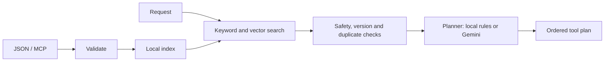

<h1>
  <picture>
    <source media="(prefers-color-scheme: dark)" srcset="brand/logo-dark.svg">
    
  </picture>
</h1>

**Find the right tools for an AI agent without sending the entire tool catalog into every prompt.**

ToolSpotter takes a request in plain language and a large tool catalog, and returns a **short, ordered list of tools** for an AI agent. It selects tools; it does **not** run them.

- **Works without an API key.** Local keyword and vector search with safety checks; an optional Gemini planner.
- **Safe by default.** Asks before unclear or destructive requests, and returns nothing when no tool fits.
- **Easy to feed.** Load a JSON file or scan an MCP server.
- **Three ways in.** Website, REST API and MCP server, from one Python process and one SQLite file.

## Quick start

Python 3.11 or newer:

```bash
python3 -m venv .venv && source .venv/bin/activate
pip install -e ".[api,mcp]"
toolspotter serve --catalog tests/data/catalog.json    # a sample catalog; use your own
```

| Open | For |
|---|---|
| http://127.0.0.1:8080/ui/ | Website: dashboard, try a request, add and edit tools |
| http://127.0.0.1:8080/docs | API documentation (needs an internet connection) |

Ask for tools over REST:

```bash
curl -s -X POST http://127.0.0.1:8080/route \
  -H 'content-type: application/json' \
  -d '{"query": "Check the health status of the production server"}'
```

Other ways to run it:

```bash
toolspotter init                                       # optional: set up Gemini
toolspotter mcp --catalog tests/data/catalog.json      # MCP server for an agent
toolspotter serve --import-mcp "python my_server.py"   # load tools from an MCP server
docker build -t toolspotter . && docker run -p 127.0.0.1:8080:8080 toolspotter
```

## Evaluation

110 held-out requests across GitHub MCP tools, Playwright MCP tools and a custom catalog. A request passes only if the answer is exactly right: the expected tools in order, a clarifying question, or nothing.

| Setup | `github` (40) | `playwright` (10) | `custom` (60) | All (110) |
|---|---:|---:|---:|---:|
| Keyword search baseline | 18 (45%) | 6 (60%) | 20 (33%) | 44 (40%) |
| Local mode (no LLM, no key) | 25 (62%) | 8 (80%) | 39 (65%) | **72 (65%)** |
| Gemini planner | 37 (92%) | 10 (100%) | 57 (95%) | **104 (95%)** |

Read these with care:

- The requests were **written with an AI assistant and not independently reviewed**, which may favour the Gemini score.
- On requests that need one tool, local mode is **not clearly better than keyword search**. Its gains are in asking questions, rejecting unrelated requests and planning several steps.
- The Gemini run used `gemini-3.5-flash-lite` on 2026-11-28: 125 calls, none failed.

[Full results, limits and how to run it](docs/evaluation.md)

## How it works



Python 3.11+, Pydantic, TF-IDF and BM25, SQLite, FastAPI, the MCP SDK and plain JavaScript.

## Limitations

- **No login, TLS or rate limiting.** It listens on this machine only unless you change that.
- **English only**, including the confirmation check for destructive requests.
- Local search matches words, not meaning.
- Recent requests are saved as plain text; `--no-persist` turns saving off.

## Documentation

| Document | Contents |
|---|---|
| [Using ToolSpotter](docs/usage.md) | Website, MCP servers, tool format, REST API, Docker, saved data |
| [Evaluation](docs/evaluation.md) | Results in detail |
| [Architecture](docs/design/architecture.md) and [engine design](docs/design/engine-design.md) | How it is built |
| [Integrations](docs/design/integrations.md) | Calling it from an agent |

Run the tests with `pip install -e ".[api,mcp,test]"` and then `pytest`.

## License

[MIT](LICENSE) © 2026 Akshraj Chavda.

The GitHub and Playwright tool definitions in `eval/` belong to their authors and keep their own licences: see [sources](eval/SOURCES.md).
