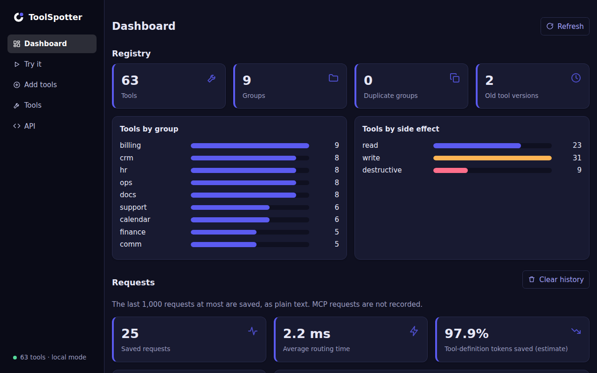
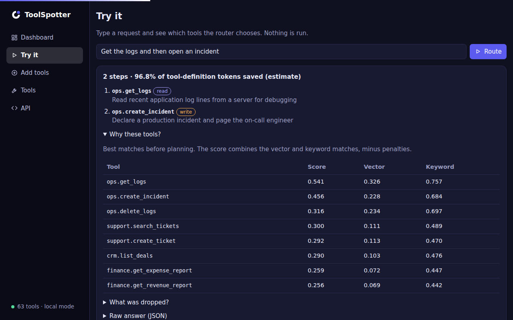
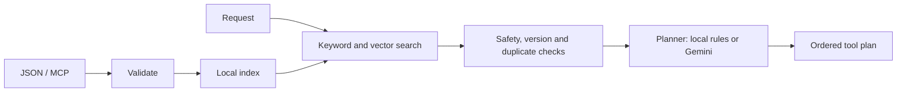

<div align="center">

<picture>
  <source media="(prefers-color-scheme: dark)" srcset="brand/logo-dark.svg">
  
</picture>

**Find the right tools for an AI agent without sending the entire tool catalog into every prompt.**

[](pyproject.toml)
[](LICENSE)
[](docs/usage.md#manage-tools-over-rest)
[](#use-it-from-an-agent)

<a href="#quick-start">Quick start</a> ·
<a href="#use-it-from-an-agent">Agents</a> ·
<a href="#evaluation">Evaluation</a> ·
<a href="#how-it-works">How it works</a> ·
<a href="#documentation">Documentation</a>

</div>



## Why ToolSpotter

An agent with many tools has to read every definition before it can act, which costs tokens and makes similar tools easy to confuse. ToolSpotter takes a request in plain language and returns a **short, ordered list of tools** for the agent to use. It selects tools; it does **not** run them.

## Features

| | |
|---|---|
| **Works without an API key** | Local keyword and vector search with rule-based planning |
| **Optional LLM planner** | Gemini, with the local planner as the fallback |
| **Careful by default** | Asks before unclear or destructive requests; returns nothing when no tool fits |
| **Easy to load** | JSON catalog, upload with preview, or a scan of a local or remote MCP server |
| **Three interfaces** | Website, REST API and read-only MCP server |
| **Small to run** | One Python process and one SQLite file |

## Quick start

You need Python 3.11 or newer.

```bash
git clone https://github.com/akshraj-05/toolspotter.git
cd toolspotter
python3 -m venv .venv && source .venv/bin/activate
pip install -e ".[api,mcp]"
toolspotter serve --catalog tests/data/catalog.json    # a sample catalog; use your own
```

Then open the website at http://127.0.0.1:8080/ui/ or the API documentation at http://127.0.0.1:8080/docs (the latter needs an internet connection).

With Docker:

```bash
docker build -t toolspotter .
docker run -p 127.0.0.1:8080:8080 toolspotter           # starts empty: add tools on the website
```

### Ask for tools

```bash
curl -s -X POST http://127.0.0.1:8080/route \
  -H 'content-type: application/json' \
  -d '{"query": "Get the logs and then open an incident"}'
```

With the larger catalog in `eval/custom/catalog.json`, the answer includes (shortened):

```json
{
  "selected_tools": ["ops.get_logs", "ops.create_incident"],
  "plan": ["ops.get_logs", "ops.create_incident"],
  "clarify": false,
  "clarify_question": null,
  "tokens_saved_pct": 0.9677
}
```

The full response also holds the selected tool definitions and a trace of the scores. `tokens_saved_pct` is an estimate of the tool-definition tokens saved.



## Use it from an agent

Call `POST /route` before your model call, or add ToolSpotter to an MCP host. It offers `find_tools` and `registry_status`, and cannot change your tools.

```json
{
  "mcpServers": {
    "toolspotter": {
      "command": "toolspotter",
      "args": ["mcp", "--catalog", "/path/to/catalog.json"]
    }
  }
}
```

To load tools straight from another MCP server:

```bash
toolspotter serve --import-mcp "python my_server.py"
```

## Configuration

The defaults need no setup. Run `toolspotter init`, or set environment variables:

| Variable | Default | Purpose |
|---|---|---|
| `TOOLSPOTTER_LLM_PROVIDER` | `none` | `gemini` turns on the LLM planner |
| `GEMINI_API_KEY` | | Your key, needed for Gemini |
| `TOOLSPOTTER_LLM_MODEL` | `gemini-3.5-flash-lite` | Planner model |
| `TOOLSPOTTER_EMBEDDING_PROVIDER` | `local` | `local` or `gemini` vectors |
| `TOOLSPOTTER_MAX_TOOLS` | `5000` | Largest registry |
| `TOOLSPOTTER_LOG_LEVEL` | `INFO` | Log detail |

## Evaluation

110 held-out requests across GitHub MCP tools, Playwright MCP tools and a custom catalog. A request passes only if the answer is exactly right: the expected tools in order, a clarifying question, or nothing.

| Setup | `github` (40) | `playwright` (10) | `custom` (60) | All (110) |
|---|---:|---:|---:|---:|
| Keyword search baseline | 18 (45%) | 6 (60%) | 20 (33%) | 44 (40%) |
| Local mode (no LLM, no key) | 25 (62%) | 8 (80%) | 39 (65%) | **72 (65%)** |
| Gemini planner | 37 (92%) | 10 (100%) | 57 (95%) | **104 (95%)** |

Read these with care:

- The requests were **written with an AI assistant and not independently reviewed**, which may favour the Gemini score.
- On requests that need one tool, local mode is **not clearly better than keyword search**. Its gains are in asking questions, rejecting unrelated requests and planning several steps.
- The Gemini run used `gemini-3.5-flash-lite` on 2026-11-28: 125 calls, none failed.

[Full results, limits and how to run it](docs/evaluation.md)

## How it works



Built with Python, Pydantic, TF-IDF and BM25, SQLite, FastAPI, the MCP SDK and plain JavaScript.

## Limitations

- **No login, TLS or rate limiting.** It listens on this machine only unless you change that.
- **English only**, including the confirmation check for destructive requests.
- Local search matches words, not meaning.
- Recent requests are saved as plain text; `--no-persist` turns saving off.

## Documentation

| Document | Contents |
|---|---|
| [Using ToolSpotter](docs/usage.md) | Website, MCP servers, tool format, REST API, Docker, saved data |
| [Evaluation](docs/evaluation.md) | Results in detail |
| [Architecture](docs/design/architecture.md) | How the parts fit together |
| [Engine design](docs/design/engine-design.md) | The rules in each routing step |
| [Integrations](docs/design/integrations.md) | Calling it from an agent |

## Contributing

Issues and pull requests are welcome.

```bash
pip install -e ".[api,mcp,test]"
pytest                                   # runs offline
python eval/run.py                       # tuning half, with failures listed
```

Add tests with your change. Improve routing with general rules, check them on the tuning half, and do not tune against the final half.

## License

[MIT](LICENSE) © 2026 Akshraj Chavda.

The GitHub and Playwright tool definitions in `eval/` belong to their authors and keep their own licences: see [sources](eval/SOURCES.md).
