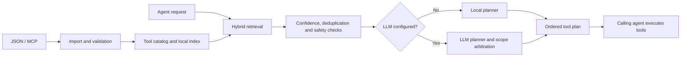

# Tool Router

**Find the right tools for an AI agent without sending the entire tool catalog into every prompt.**

Tool Router is a Python routing service for large tool catalogs. Register tools once, then submit a natural-language request to receive a small, ordered tool plan. It combines local retrieval and deterministic safeguards with an optional LLM planner.

## Evaluation snapshot

Measured during development on an internal **29-query evaluation suite** and a **64-tool catalog**. The evaluation harness and catalog are not included in this repository, so these are reported development results rather than independently reproducible results from a fresh checkout.

| Configuration | Accuracy | Prompt-token savings |
|---|---:|---:|
| Keyword/cluster baseline | 7/29 (24%) | 94% |
| Local-only router | 24/29 (83%) | 98% |
| Hybrid router (LLM + HyDE + scope arbitration) | **26/29 (90%)** | **98%** |

Additional development checks:
- Registry validation fixtures: **11/11** passed.
- Catalog mutation scenarios: **8/8** passed.
- Held-out query set: **10/12 (83%)**.
- At 104 tools, the measured token-savings ratio was **97%**.

See [the evaluation report](docs/eval_report.md) for methodology, category breakdowns, trade-offs and limitations.

## What it does

1. **Register tools** from JSON or an MCP server.
2. **Validate and normalize** tool definitions before they enter the catalog.
3. **Retrieve candidates** using lexical, dense and capability signals.
4. **Apply safeguards** for confidence, duplicates, versions, side effects and out-of-scope requests.
5. **Build a compact plan** locally or with an optional LLM.
6. **Return ordered tool selections** to the calling agent.

Tool Router selects tools; it does **not** execute them.

## Interfaces

The same routing engine is available through:

- CLI: initialize configuration, import catalogs and run the service.
- REST API: expose routing and registry operations through FastAPI.
- MCP server: expose the `find_tools` capability to MCP-compatible agents.
- Docker: run the service in a container.

## Architecture



For the detailed design, see [architecture](docs/design/architecture.md), [engine design](docs/design/engine-design.md), and [integration notes](docs/design/integrations.md).

## Technology

- Python 3.11+
- Pydantic
- TF-IDF and BM25 retrieval
- Optional Gemini provider integration
- FastAPI and Uvicorn (optional API extra)
- MCP SDK (optional MCP extra)
- Docker

The default local path works without an LLM API key. Gemini was used for the reported live hybrid evaluation. ChromaDB and sentence-transformers are listed as exploratory optional dependencies and are not used by the current routing engine.

## Quick start

Create an environment and install the API and MCP extras:

```bash
python3.11 -m venv .venv
source .venv/bin/activate
pip install -e ".[api,mcp]"
```

Initialize configuration (optional for local-only routing):

```bash
tool-router init
```

Run the service with a tool catalog:

```bash
tool-router serve --catalog path/to/tools_catalog.json
```

The REST API documentation is available at `http://localhost:8080/docs` when the service is running.

To run the MCP server instead:

```bash
tool-router mcp --catalog path/to/tools_catalog.json
```

### Load tools straight from an MCP server

Point the router at an MCP server and it scans the server's tools at startup:

```bash
tool-router serve --host 127.0.0.1 --import-mcp "python my_server.py"
tool-router mcp --import-mcp "python my_server.py"
```

- Quote the whole command. Repeat `--import-mcp` for several servers, and add `--catalog file.json` to combine them with a file.
- The server gets only a minimal environment. Pass a variable it needs by name: `--mcp-env GITHUB_TOKEN`.
- The scan gives up after 30 seconds (`--mcp-timeout`). If it fails, or finds no usable tools, the router does not start.
- Tools that fail the intake checks are skipped and listed, for example for a description shorter than 6 words or more than 12 parameters.
- Each tool keeps its original name in `source.name`; use that name to call it on its server.
- A tool is marked destructive if the server says so or its name contains a word such as `delete` or `restart`. Other destructive tools may not be recognised.
- Only local (stdio) servers are supported. Restart the router to pick up changes.

`--import-mcp` runs the command you give it, so only use servers you trust. It is available on the command line only, not through the REST API.

To review the tools before loading them, write them to a file instead:

```bash
tool-router import-mcp --command python --args my_server.py -o tools.json
tool-router serve --catalog tools.json
```

For Docker:

```bash
docker build -t tool-router .
docker run -p 8080:8080 tool-router
```

## Running the tests

```bash
pip install -e ".[api,mcp,test]"
pytest
```

The suite runs fully offline: LLM behaviour is driven by a scripted fake chat client, and each test uses its own temporary data and config directories.

See `.env.example` and [onboarding documentation](docs/design/onboarding.md) for configuration and catalog details.

## LangGraph example

[`examples/langgraph_agent/`](examples/langgraph_agent/README.md) shows the router as a step in a LangGraph agent: it picks the tools first, and the model sees only those. The tools are simulated, and the offline comparison needs no API key. LangGraph is a dependency of the example only, not of Tool Router.

## Evaluation and limitations

The headline figures above come from a development evaluation suite that is not shipped in this repository. Treat them as measured project results, not a guarantee for a different catalog or workload. The report documents known failure categories and the difference between local-only and LLM-assisted routing.

**Language:** English only. Other languages are not supported, including the confirmation check for destructive requests.

The local planner is deterministic and works offline. LLM-assisted features depend on provider availability, model behaviour, credentials and rate limits; failures are designed to fall back to the local path.

## Repository guide

| Path | Purpose |
|---|---|
| `tool_router/engine/` | Retrieval, confidence, planning and routing pipeline |
| `tool_router/importers/` | MCP catalog importer |
| `tool_router/providers/` | Local and hosted model providers |
| `tool_router/api.py` | REST API |
| `tool_router/mcp_server.py` | MCP server |
| `tool_router/cli.py` | Command-line interface |
| `docs/eval_report.md` | Evaluation results and methodology |
| `docs/design/` | Architecture and design decisions |

## License

The package metadata currently identifies the project license as **Proprietary**. Check the repository's licensing terms before redistributing or reusing the code.
