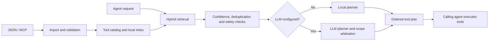

# Tool Router

**Find the right tools for an AI agent without sending the entire tool catalog into every prompt.**

Tool Router is a Python routing service for large tool catalogs. Register tools once, then submit a natural-language request to receive a small, ordered tool plan. It combines local retrieval and deterministic safeguards with an optional LLM planner.

## Evaluation

The test data and the scoring command are in [`eval/`](eval/). A request passes only if the answer is exactly right: the expected tools in the expected order, a clarifying question, or nothing.

| Test set | Tools | Requests | Tool definitions from |
|---|---:|---:|---|
| `github` | 84 | 81 | GitHub MCP server |
| `playwright` | 17 | 19 | Playwright MCP server |
| `custom` | 63 | 120 | Written for this repository |

See [sources and licences](eval/SOURCES.md). Each set is split into a tuning half and a final half.

### Results on the final halves, current code

| Setup | `github` (40) | `playwright` (10) | `custom` (60) | All (110) |
|---|---:|---:|---:|---:|
| Keyword search baseline | 18 (45%) | 6 (60%) | 20 (33%) | 44 (40%) |
| Local mode (no LLM, no key) | 25 (62%) | 8 (80%) | 39 (65%) | **72 (65%)** |

| Request type, all sets | Local mode |
|---|---:|
| One tool | 25/38 |
| Choosing between similar tools | 15/24 |
| Several tools in order | 12/20 |
| Current or old tool version (`custom` only) | 3/6 |
| Unclear request: should ask a question | 9/11 |
| No suitable tool: should return nothing | 8/11 |

### With the Gemini planner (earlier measurement)

Measured on 2026-11-27 with `gemini-3.5-flash-lite` and local vectors: one run, no failed calls.

| Final half | Passed |
|---|---:|
| `custom` | **57/60 (95%)** |
| GitHub and Playwright tools together in one catalog | **45/50 (90%)** |
| Both | **102/110 (93%)** |

These numbers are **not** from the current code or layout. Since then, a parameter-matching score was removed from retrieval, the vector and keyword weights changed, and the GitHub and Playwright tools were split into separate catalogs. They have not been re-run with Gemini yet.

### What the results show

- **The LLM planner made the largest difference** in the earlier run, mostly for similar tools, multi-step requests and unrelated requests.
- **Choosing one tool in local mode is not clearly better than keyword search.** On requests that expect exactly one tool:

  | | `github` | `playwright` | `custom` |
  |---|---:|---:|---:|
  | Keyword search | 18/26 | 6/6 | 20/36 |
  | Local mode | 17/26 | 5/6 | 21/36 |

  Local mode's advantage is asking questions, rejecting unrelated requests and planning several steps, which the baseline cannot do.
- **Speed and cost:** local mode answers in milliseconds. With Gemini a request took roughly 1 to 2 seconds and needs an API key.
- **Gemini embeddings** with the local planner scored about the same as local vectors on the tuning halves (earlier code), so they are not the recommended setup.

### Limits of these results

- The requests were written with an AI assistant and have not been independently reviewed. An LLM may find requests written this way easier than real users' requests, which would flatter the Gemini score.
- The sets are small, `playwright` especially: one request changes its final score by 10 points, and it has no unclear requests.
- Smaller catalogs are easier. Splitting GitHub and Playwright raised local scores on the same requests, from 30/50 to 33/50, without any change to the router.
- 20 of the 121 tools in those two servers were rejected by the router's validation and are not part of the test.
- Fixes are guided by the tuning halves only. The command does not list failures from the final halves.

### Run it yourself

```bash
pip install -e .
python eval/run.py --split final                         # local mode, GitHub set
python eval/run.py --set playwright --split final
python eval/run.py --set custom --split final
python eval/run.py --set github --split final --baseline

export GEMINI_API_KEY=your-key
TOOL_ROUTER_LLM_PROVIDER=gemini TOOL_ROUTER_LLM_MODEL=gemini-3.5-flash-lite \
  python eval/run.py --split final --from-env --delay 4.5
```

`--delay` keeps within free-tier rate limits. Failed Gemini calls are counted, and a run with failures is marked as not a clean score.

**Known causes of local-mode failures** (seen in the tuning halves)

- Local retrieval matches words, not meaning: "is web-01 up" finds no tool.
- The local planner finds steps at words such as "then", before a verb that starts a tool name, or where both sides of "and" clearly match different tools. It still loses steps when one side matches poorly.
- Similar tools are confused, for example reading an invoice instead of creating one.

Earlier development results came from a different 29-query suite on older code that is not in this repository, and are not comparable. See [the earlier evaluation report](docs/eval_report.md).

## What it does

1. **Register tools** from JSON or an MCP server.
2. **Validate and normalize** tool definitions before they enter the catalog.
3. **Retrieve candidates** using lexical (BM25) and vector signals.
4. **Apply safeguards** for confidence, duplicates, versions, side effects and out-of-scope requests.
5. **Build a compact plan** locally or with an optional LLM.
6. **Return ordered tool selections** to the calling agent.

Tool Router selects tools; it does **not** execute them.

## Interfaces

The same routing engine is available through:

- CLI: initialize configuration, import catalogs and run the service.
- REST API: expose routing and registry operations through FastAPI.
- MCP server: expose the `find_tools` capability to MCP-compatible agents.
- Docker: run the service in a container.

## Architecture



For the detailed design, see [architecture](docs/design/architecture.md), [engine design](docs/design/engine-design.md), and [integration notes](docs/design/integrations.md).

## Technology

- Python 3.11+
- Pydantic
- TF-IDF and BM25 retrieval
- Optional Gemini provider integration
- FastAPI and Uvicorn (optional API extra)
- MCP SDK (optional MCP extra)
- Docker

The default local path works without an LLM API key. With Gemini, the default model is `gemini-3.5-flash-lite`; see [Evaluation](#evaluation) for what it changes.

## Quick start

With Python 3.11 or newer, create an environment and install the API and MCP extras:

```bash
python3 -m venv .venv
source .venv/bin/activate
pip install -e ".[api,mcp]"
```

Initialize configuration (optional for local-only routing):

```bash
tool-router init
```

Run the service with a tool catalog:

```bash
tool-router serve --catalog tests/data/catalog.json   # a sample catalog; use your own file
```

The REST API documentation is available at `http://localhost:8080/docs` when the service is running.

To run the MCP server instead:

```bash
tool-router mcp --catalog tests/data/catalog.json
```

### Load tools straight from an MCP server

Point the router at an MCP server and it scans the server's tools at startup:

```bash
tool-router serve --host 127.0.0.1 --import-mcp "python my_server.py"
tool-router mcp --import-mcp "python my_server.py"
```

- Quote the whole command. Repeat `--import-mcp` for several servers, and add `--catalog file.json` to combine them with a file.
- The server gets only a minimal environment. Pass a variable it needs by name: `--mcp-env GITHUB_TOKEN`.
- The scan gives up after 30 seconds (`--mcp-timeout`). If it fails, or finds no usable tools, the router does not start.
- Tools that fail the intake checks are skipped and listed, for example for a description shorter than 6 words or more than 12 parameters.
- Each tool keeps its original name in `source.name`; use that name to call it on its server.
- A tool is marked destructive if the server says so or its name contains a word such as `delete` or `restart`. Other destructive tools may not be recognised.
- Restart the router to pick up changes on a server.

`--import-mcp` runs the command or contacts the address you give it, so only use servers you trust. It is available on the command line only, not through the REST API.

#### Remote servers

Give a URL instead of a command (Streamable HTTP):

Authentication is by HTTP header. `--mcp-header-env HEADER=NAME` sends `HEADER` with the value of the environment variable `NAME`:

```bash
read -rs TOKEN                                  # paste the token; it stays out of shell history
export SHOP_AUTH="Bearer $TOKEN"; unset TOKEN
tool-router serve --host 127.0.0.1 \
    --import-mcp "https://shop.example.com/mcp" --mcp-header-env Authorization=SHOP_AUTH
```

| The server expects | Variable holds | Option |
|---|---|---|
| Nothing | — | none |
| Bearer token | `Bearer <token>` | `--mcp-header-env Authorization=NAME` |
| API key or another header | the key | `--mcp-header-env X-API-Key=NAME` |
| Basic | `Basic <encoded>` | `--mcp-header-env Authorization=NAME` |
| Several headers | one variable each | repeat the option |

- Values are read from environment variables and are not printed or stored with the tools.
- `https` is required; plain `http` is accepted for `localhost` only.
- Redirects are followed only within the same server. A redirect to another server is refused, so your token is never sent elsewhere.
- A user name or password inside the URL is refused.
- `--mcp-header-env` works with **one** remote server at a time, so one server's secret is never sent to another.
- **Not supported:** OAuth (including browser sign-in), client certificates and the older SSE transport.
- If any server cannot be scanned, the router does not start.

To review the tools before loading them, write them to a file instead:

```bash
tool-router import-mcp --command python --args my_server.py -o tools.json
# remote: tool-router import-mcp --url https://shop.example.com/mcp --header-env Authorization=SHOP_AUTH -o tools.json
tool-router serve --catalog tools.json
```

### Tool format

```json
{
  "name": "send_email",
  "description": "Send an email message to a recipient with a subject and body",
  "parameters": [{"name": "to", "type": "string", "required": true}],
  "side_effects": "write",
  "cluster": "comm",
  "id": "comm.send_email"
}
```

`name`, `description` and `parameters` are required. `cluster` defaults to `general`, and `id` is built as `cluster.name` if you leave it out. `side_effects` is `read`, `write` or `destructive`; any other value is refused. If you leave it out it is guessed from the name (`delete_…`, `restart_…` and similar are destructive; `get_…`, `list_…` and similar are read; everything else is write). The guess misses names such as `close_account`, so set it for any tool that changes or deletes something. An update that omits it keeps the current value. Optional: `tags`, `version`, `deprecated`, `replaced_by`.

**Versions.** To update a tool, replace it with `PUT` and change `version`, which is information only. If the old and new versions must both stay callable, register both and mark the old one `"deprecated": true` with `"replaced_by": "<new id>"`. The router then returns the new one unless the request asks for the legacy or old one. Names are never used to guess versions.

A catalog file is `{"tools": [ ... ]}`.

### Validation

A catalog file, an API upload, single-tool requests and MCP scans all apply the same rules.

| Rule | Limit |
|---|---|
| Required | `name`, `description`, `parameters` |
| Unknown fields and wrong data types | Refused |
| `name` | snake_case, up to 128 characters |
| `description` | 6 words to 500 characters |
| `parameters` | Up to 12 objects, each with a unique `name`; `type` is `string`, `number`, `integer`, `boolean`, `array` or `object` |
| `replaced_by` | Must name an existing tool, with no cycle; that tool cannot be deleted while referenced |
| Catalog file or request body | Up to 5 MB (`TOOL_ROUTER_MAX_BYTES`) |
| Tools in a registry | Up to 5,000 (`TOOL_ROUTER_MAX_TOOLS`) |

If a catalog has invalid tools, **nothing is loaded** and every problem is listed (over REST: status 422 with a `rejected` list). Check a file beforehand with `tool-router validate tools.json`, which accepts a list of tools or a `{"tools": [...]}` object. An MCP scan skips invalid tools and lists them.

### Manage tools over REST

| Request | Action |
|---|---|
| `POST /registry` | Load or replace the whole catalog |
| `GET /registry/tools` | List all tools |
| `GET /registry/tools/{id}` | Read one tool |
| `POST /registry/tools` | Create one tool |
| `PUT /registry/tools/{id}` | Replace one tool (its id cannot change) |
| `DELETE /registry/tools/{id}` | Delete one tool |
| `PATCH /registry/mutate` | Add and remove several tools at once |
| `GET /history` | Totals and the most recent requests (`?limit=20`) |
| `DELETE /history` | Delete the saved requests |

A rejected create or update changes nothing. Changes are saved to the `.tool-router` folder (see below).

### Network access

**The REST API has no authentication**, so it is local by default.

| Setting | Who can use the API |
|---|---|
| default (`--host 127.0.0.1`) | Programs on this machine only |
| `--host 0.0.0.0` | Anyone who can connect: they can read, change and delete tools and use `/setup`. The CLI prints a warning. |

- A local server answers only requests whose `Host` header is `localhost` or a loopback address, which blocks web pages that point their own domain at your machine. Behind a proxy or a custom host name, add `--allow-host NAME`.
- "This machine" includes every program and user account on it. Under WSL, Windows programs can usually reach it too.
- Before exposing it to a network you do not trust, put authentication and TLS in front of it.

For Docker:

```bash
docker build -t tool-router .
docker run -p 127.0.0.1:8080:8080 tool-router
```

Inside the container the service must listen on `0.0.0.0` (the image does this), so publish the port on `127.0.0.1` as above to keep it local. To also check the `Host` header there:

```bash
docker run -p 127.0.0.1:8080:8080 tool-router serve --host 0.0.0.0 --port 8080 --allow-host localhost
```

To keep registered tools when the container is replaced, mount a folder. **Create it first:** if it does not exist, Docker creates it as root and the router stops with `Permission denied`.

```bash
mkdir -p .tool-router
docker run -p 127.0.0.1:8080:8080 \
  -v "$PWD/.tool-router:/app/.tool-router" \
  -v "$PWD/tests/data/catalog.json:/app/catalog.json:ro" \
  tool-router serve --host 0.0.0.0 --port 8080 --allow-host localhost --catalog /app/catalog.json
```

- The container runs as user 1000. If your user id is different, add `--user "$(id -u):$(id -g)"`. Use it only together with the mounted folder.
- To use Gemini, add `-e GEMINI_API_KEY -e TOOL_ROUTER_LLM_PROVIDER=gemini`. The key is passed at run time and is not stored in the image.

For the MCP server, keep standard input open with `-i`. An MCP host can start it with:

```bash
docker run -i --rm -v "/path/to/catalog.json:/app/catalog.json:ro" tool-router mcp --catalog /app/catalog.json --no-persist
```

A local MCP server given to `--import-mcp` runs inside the container, so its code and dependencies must be there.

## Saved registry (`.tool-router/`)

`serve` and `mcp` keep everything they save in one SQLite file, in a `.tool-router` folder in the directory you start them from, and load it again on the next start.

```
.tool-router/
├── .gitignore         ignores everything in the folder
└── router.db          tools and their history, saved vectors, recent requests
```

```bash
tool-router serve --catalog tests/data/catalog.json   # first start: loads and saves
tool-router serve                                      # later: loads the saved tools
tool-router export -o tools.json                       # saved tools as a catalog file
```

- **Upsert.** With `--catalog` or `--import-mcp`, tools are matched by `id`: new ones are added and existing ones take the incoming definition. Saved tools missing from the input are **kept**; add `--prune` to remove them. The incoming definition wins over an earlier API edit.
- **Versions.** A changed definition becomes the current entry with a higher version, and the old one moves to `history` (the last 10 per tool). History is never routed.

| Change | Version |
|---|---|
| New tool | `1.0.0` |
| Description, side effects, tags and other details | third number |
| Optional parameter added, parameter made optional, parameter description | second number |
| Name changed; parameter removed, renamed, retyped or made required | first number |

  A higher `version` that you supply is used instead.
- **Vectors.** Saved vectors are computed again whenever they cannot be used. One method's vectors are held at a time, and changing `TOOL_ROUTER_EMBEDDING_PROVIDER` replaces them. While Gemini is unavailable nothing is written, so its saved vectors survive an outage.
- **Faster restarts.** Near-duplicate tools are found once and reused until a tool, a threshold or the vector method changes. `serve --rebuild` recomputes everything.
- **Safety.** A change is saved in one transaction before it takes effect; if saving fails, nothing changes. The router never deletes `router.db`: a damaged file stops startup and is left as it is. Settings and API keys are never written here, and the file is readable only by you.
- **Request history.** The last 1,000 requests to `POST /route` are saved with the first 500 characters of each query, **as plain text**. `DELETE /history` removes them. Saving happens in the background; `--no-persist` turns it off. MCP requests are not recorded.
- **Options.** `--state-dir PATH` uses another folder (useful when an MCP host starts the router from an unexpected directory). `--no-persist` keeps everything in memory.
- **Limit.** Run one router per folder; two would overwrite each other's changes.
- **Docker.** Mount the folder to keep it, and create it first: see [Network access](#network-access).

## Running the tests

```bash
pip install -e ".[api,mcp,test]"
pytest
```

The suite runs fully offline: LLM behaviour is driven by a scripted fake chat client, and each test uses its own temporary data and config directories.

See `.env.example` and [onboarding documentation](docs/design/onboarding.md) for configuration and catalog details.

## Limitations

[Evaluation](#evaluation) results apply to the test set in this repository. They are not a guarantee for a different catalog or workload.

**Language:** English only. Other languages are not supported, including the confirmation check for destructive requests.

If Gemini embeddings fail, the router uses local embeddings for that query (or for that index, if the failure happens while indexing) and records `embedding_fallback` in the trace for query failures. Rate limits are retried first, so a request can wait over a minute before falling back.

The local planner is deterministic and works offline. LLM-assisted features depend on provider availability, model behaviour, credentials and rate limits; failures are designed to fall back to the local path.

## Repository guide

| Path | Purpose |
|---|---|
| `tool_router/engine/` | Retrieval, confidence, planning and routing pipeline |
| `tool_router/importers/` | MCP catalog importer |
| `tool_router/providers/` | Local and hosted model providers |
| `tool_router/api.py` | REST API |
| `tool_router/mcp_server.py` | MCP server |
| `tool_router/cli.py` | Command-line interface |
| `tool_router/database.py`, `state.py`, `history.py` | The database, the saved registry and request history |
| `eval/` | Test catalogs, requests, scoring command and keyword baseline |
| `docs/eval_report.md` | Earlier development results |
| `docs/design/` | Architecture and design decisions |

## License

The package metadata currently identifies the project license as **Proprietary**. Check the repository's licensing terms before redistributing or reusing the code.
