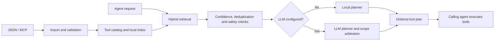

# Tool Router

**Find the right tools for an AI agent without sending the entire tool catalog into every prompt.**

Tool Router is a Python routing service for large tool catalogs. Register tools once, then submit a natural-language request to receive a small, ordered tool plan. It combines local retrieval and deterministic safeguards with an optional LLM planner.

## Evaluation snapshot

Measured during development on an internal **29-query evaluation suite** and a **64-tool catalog**. The evaluation harness and catalog are not included in this repository, so these are reported development results rather than independently reproducible results from a fresh checkout.

| Configuration | Accuracy | Prompt-token savings |
|---|---:|---:|
| Keyword/cluster baseline | 7/29 (24%) | 94% |
| Local-only router | 24/29 (83%) | 98% |
| Hybrid router (LLM + HyDE + scope arbitration) | **26/29 (90%)** | **98%** |

Additional development checks:
- Registry validation fixtures: **11/11** passed.
- Catalog mutation scenarios: **8/8** passed.
- Held-out query set: **10/12 (83%)**.
- At 104 tools, the measured token-savings ratio was **97%**.

See [the evaluation report](docs/eval_report.md) for methodology, category breakdowns, trade-offs and limitations.

## What it does

1. **Register tools** from JSON or an MCP server.
2. **Validate and normalize** tool definitions before they enter the catalog.
3. **Retrieve candidates** using lexical, dense and capability signals.
4. **Apply safeguards** for confidence, duplicates, versions, side effects and out-of-scope requests.
5. **Build a compact plan** locally or with an optional LLM.
6. **Return ordered tool selections** to the calling agent.

Tool Router selects tools; it does **not** execute them.

## Interfaces

The same routing engine is available through:

- CLI: initialize configuration, import catalogs and run the service.
- REST API: expose routing and registry operations through FastAPI.
- MCP server: expose the `find_tools` capability to MCP-compatible agents.
- Docker: run the service in a container.

## Architecture



For the detailed design, see [architecture](docs/design/architecture.md), [engine design](docs/design/engine-design.md), and [integration notes](docs/design/integrations.md).

## Technology

- Python 3.11+
- Pydantic
- TF-IDF and BM25 retrieval
- Optional Gemini provider integration
- FastAPI and Uvicorn (optional API extra)
- MCP SDK (optional MCP extra)
- Docker

The default local path works without an LLM API key. Gemini was used for the reported live hybrid evaluation.

## Quick start

Create an environment and install the API and MCP extras:

```bash
python3.11 -m venv .venv
source .venv/bin/activate
pip install -e ".[api,mcp]"
```

Initialize configuration (optional for local-only routing):

```bash
tool-router init
```

Run the service with a tool catalog:

```bash
tool-router serve --catalog path/to/tools_catalog.json
```

The REST API documentation is available at `http://localhost:8080/docs` when the service is running.

To run the MCP server instead:

```bash
tool-router mcp --catalog path/to/tools_catalog.json
```

### Load tools straight from an MCP server

Point the router at an MCP server and it scans the server's tools at startup:

```bash
tool-router serve --host 127.0.0.1 --import-mcp "python my_server.py"
tool-router mcp --import-mcp "python my_server.py"
```

- Quote the whole command. Repeat `--import-mcp` for several servers, and add `--catalog file.json` to combine them with a file.
- The server gets only a minimal environment. Pass a variable it needs by name: `--mcp-env GITHUB_TOKEN`.
- The scan gives up after 30 seconds (`--mcp-timeout`). If it fails, or finds no usable tools, the router does not start.
- Tools that fail the intake checks are skipped and listed, for example for a description shorter than 6 words or more than 12 parameters.
- Each tool keeps its original name in `source.name`; use that name to call it on its server.
- A tool is marked destructive if the server says so or its name contains a word such as `delete` or `restart`. Other destructive tools may not be recognised.
- Restart the router to pick up changes on a server.

`--import-mcp` runs the command or contacts the address you give it, so only use servers you trust. It is available on the command line only, not through the REST API.

#### Remote servers

Give a URL instead of a command (Streamable HTTP):

Authentication is by HTTP header. `--mcp-header-env HEADER=NAME` sends `HEADER` with the value of the environment variable `NAME`:

```bash
read -rs TOKEN                                  # paste the token; it stays out of shell history
export SHOP_AUTH="Bearer $TOKEN"; unset TOKEN
tool-router serve --host 127.0.0.1 \
    --import-mcp "https://shop.example.com/mcp" --mcp-header-env Authorization=SHOP_AUTH
```

| The server expects | Variable holds | Option |
|---|---|---|
| Nothing | — | none |
| Bearer token | `Bearer <token>` | `--mcp-header-env Authorization=NAME` |
| API key or another header | the key | `--mcp-header-env X-API-Key=NAME` |
| Basic | `Basic <encoded>` | `--mcp-header-env Authorization=NAME` |
| Several headers | one variable each | repeat the option |

- Values are read from environment variables and are not printed or stored with the tools.
- `https` is required; plain `http` is accepted for `localhost` only.
- Redirects are followed only within the same server. A redirect to another server is refused, so your token is never sent elsewhere.
- A user name or password inside the URL is refused.
- `--mcp-header-env` works with **one** remote server at a time, so one server's secret is never sent to another.
- **Not supported:** OAuth (including browser sign-in), client certificates and the older SSE transport.
- If any server cannot be scanned, the router does not start.

To review the tools before loading them, write them to a file instead:

```bash
tool-router import-mcp --command python --args my_server.py -o tools.json
# remote: tool-router import-mcp --url https://shop.example.com/mcp --header-env Authorization=SHOP_AUTH -o tools.json
tool-router serve --catalog tools.json
```

### Tool format

```json
{
  "name": "send_email",
  "description": "Send an email message to a recipient with a subject and body",
  "parameters": [{"name": "to", "type": "string", "required": true}],
  "side_effects": "write",
  "cluster": "comm",
  "id": "comm.send_email"
}
```

`name`, `description` and `parameters` are required. `cluster` defaults to `general`, and `id` is built as `cluster.name` if you leave it out. `side_effects` is `read`, `write` or `destructive`; any other value is refused. If you leave it out it is guessed from the name (`delete_…`, `restart_…` and similar are destructive; `get_…`, `list_…` and similar are read; everything else is write). The guess misses names such as `close_account`, so set it for any tool that changes or deletes something. An update that omits it keeps the current value. Optional: `tags`, `version`, `deprecated`, `replaced_by`.

**Versions.** To update a tool, replace it with `PUT` and change `version`, which is information only. If the old and new versions must both stay callable, register both and mark the old one `"deprecated": true` with `"replaced_by": "<new id>"`. The router then returns the new one unless the request asks for the legacy or old one. Names are never used to guess versions.

A catalog file is `{"tools": [ ... ]}`.

### Validation

A catalog file, an API upload, single-tool requests and MCP scans all apply the same rules.

| Rule | Limit |
|---|---|
| Required | `name`, `description`, `parameters` |
| Unknown fields and wrong data types | Refused |
| `name` | snake_case, up to 128 characters |
| `description` | 6 words to 500 characters |
| `parameters` | Up to 12 objects, each with a unique `name`; `type` is `string`, `number`, `integer`, `boolean`, `array` or `object` |
| `replaced_by` | Must name an existing tool, with no cycle; that tool cannot be deleted while referenced |
| Catalog file or request body | Up to 5 MB (`TOOL_ROUTER_MAX_BYTES`) |
| Tools in a registry | Up to 5,000 (`TOOL_ROUTER_MAX_TOOLS`) |

If a catalog has invalid tools, **nothing is loaded** and every problem is listed (over REST: status 422 with a `rejected` list). Check a file beforehand with `tool-router validate tools.json`, which accepts a list of tools or a `{"tools": [...]}` object. An MCP scan skips invalid tools and lists them.

### Manage tools over REST

| Request | Action |
|---|---|
| `POST /registry` | Load or replace the whole catalog |
| `GET /registry/tools` | List all tools |
| `GET /registry/tools/{id}` | Read one tool |
| `POST /registry/tools` | Create one tool |
| `PUT /registry/tools/{id}` | Replace one tool (its id cannot change) |
| `DELETE /registry/tools/{id}` | Delete one tool |
| `PATCH /registry/mutate` | Add and remove several tools at once |

A rejected create or update changes nothing. Changes are saved to the `.tool-router` folder (see below).

### Network access

**The REST API has no authentication**, so it is local by default.

| Setting | Who can use the API |
|---|---|
| default (`--host 127.0.0.1`) | Programs on this machine only |
| `--host 0.0.0.0` | Anyone who can connect: they can read, change and delete tools and use `/setup`. The CLI prints a warning. |

- A local server answers only requests whose `Host` header is `localhost` or a loopback address, which blocks web pages that point their own domain at your machine. Behind a proxy or a custom host name, add `--allow-host NAME`.
- "This machine" includes every program and user account on it. Under WSL, Windows programs can usually reach it too.
- Before exposing it to a network you do not trust, put authentication and TLS in front of it.

For Docker:

```bash
docker build -t tool-router .
docker run -p 127.0.0.1:8080:8080 tool-router
```

Inside the container the service must listen on `0.0.0.0` (the image does this), so publish the port on `127.0.0.1` as above to keep it local. To also check the `Host` header there:

```bash
docker run -p 127.0.0.1:8080:8080 tool-router serve --host 0.0.0.0 --port 8080 --allow-host localhost
```

## Saved registry (`.tool-router/`)

`serve` and `mcp` save registered tools and cached vectors in a `.tool-router` folder in the directory you start them from, and load them again on the next start.

```
.tool-router/
├── .gitignore         ignores everything in the folder
├── catalog.json       current tools, and the history of older definitions
└── embeddings.json    cached vectors
```

```bash
tool-router serve --catalog tests/data/catalog.json   # first start: loads and saves
tool-router serve                                      # later: loads the saved tools
```

- **Upsert.** With `--catalog` or `--import-mcp`, tools are matched by `id`: new ones are added and existing ones take the incoming definition. Saved tools missing from the input are **kept**; add `--prune` to remove them. The incoming definition wins over an earlier API edit.
- **Versions.** A changed definition becomes the current entry with a higher version, and the old one moves to `history` (the last 10 per tool). History is never routed.

| Change | Version |
|---|---|
| New tool | `1.0.0` |
| Description, side effects, tags and other details | third number |
| Optional parameter added, parameter made optional, parameter description | second number |
| Name changed; parameter removed, renamed, retyped or made required | first number |

  A higher `version` that you supply is used instead.
- **Safety.** Changes are written before they take effect; if saving fails, nothing changes. A damaged `catalog.json` stops startup and is left untouched. Settings and API keys are never written here, and the files are readable only by you.
- **Options.** `--state-dir PATH` uses another folder (useful when an MCP host starts the router from an unexpected directory). `--no-persist` keeps everything in memory.
- **Limit.** Run one router per folder; two would overwrite each other's changes.
- **Docker.** Mount the folder to keep it: `-v "$PWD/.tool-router:/app/.tool-router"` (the folder must be writable by the container user).

## Running the tests

```bash
pip install -e ".[api,mcp,test]"
pytest
```

The suite runs fully offline: LLM behaviour is driven by a scripted fake chat client, and each test uses its own temporary data and config directories.

See `.env.example` and [onboarding documentation](docs/design/onboarding.md) for configuration and catalog details.

## Evaluation and limitations

The headline figures above come from a development evaluation suite that is not shipped in this repository. Treat them as measured project results, not a guarantee for a different catalog or workload. The report documents known failure categories and the difference between local-only and LLM-assisted routing.

**Language:** English only. Other languages are not supported, including the confirmation check for destructive requests.

If Gemini embeddings fail, the router uses local embeddings for that query (or for that index, if the failure happens while indexing) and records `embedding_fallback` in the trace for query failures. Rate limits are retried first, so a request can wait over a minute before falling back.

The local planner is deterministic and works offline. LLM-assisted features depend on provider availability, model behaviour, credentials and rate limits; failures are designed to fall back to the local path.

## Repository guide

| Path | Purpose |
|---|---|
| `tool_router/engine/` | Retrieval, confidence, planning and routing pipeline |
| `tool_router/importers/` | MCP catalog importer |
| `tool_router/providers/` | Local and hosted model providers |
| `tool_router/api.py` | REST API |
| `tool_router/mcp_server.py` | MCP server |
| `tool_router/cli.py` | Command-line interface |
| `docs/eval_report.md` | Evaluation results and methodology |
| `docs/design/` | Architecture and design decisions |

## License

The package metadata currently identifies the project license as **Proprietary**. Check the repository's licensing terms before redistributing or reusing the code.
