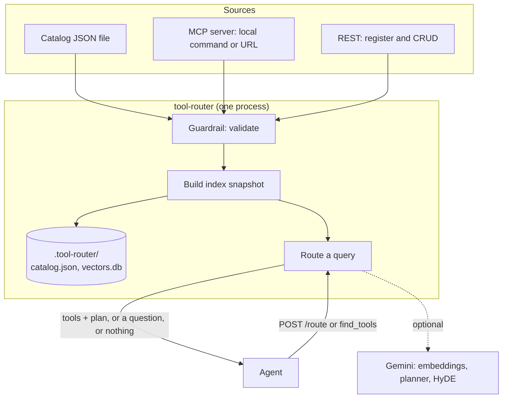

# Architecture

Tool Router takes a natural-language request and returns the few tools an agent needs, with a
suggested call order. It **selects** tools; it never runs them.

Detail documents: [engine design](engine-design.md) · [onboarding](onboarding.md) ·
[storage](storage.md) · [integrations](integrations.md) · [diagram](diagrams.md)

## 1. System shape

One Python process. No database server, no queue, no separate vector store.

## 2. Interfaces

| Interface | Command | Can change the registry |
|---|---|---|
| REST | `tool-router serve` | Yes |
| MCP over stdio (`find_tools`, `registry_status`) | `tool-router mcp` | No |

Other commands: `import-mcp` (scan an MCP server into a JSON file), `validate`, `init`,
`config`, `version`.

## 3. Lifecycle

| Stage | Through | What happens |
|---|---|---|
| Register | `--catalog`, `--import-mcp`, `POST /registry` | Validate, index, save |
| Change | `/registry/tools`, `PATCH /registry/mutate` | Validate, version, rebuild the index, save |
| Route | `POST /route`, `find_tools` | Answer from the current snapshot |

## 4. Packaging and configuration

Install from the repository (`pip install -e ".[api,mcp]"`) or build the Docker image. The
package is not published to PyPI.

Settings come from environment variables, then the stored config (`tool-router init`,
`config set`, `/setup`), then built-in defaults. The default is fully local and needs no key.
`/setup` is served by the REST API and is covered by the same network rules as the rest of it.

## 5. Providers

| Role | Default | Alternative |
|---|---|---|
| Embeddings | Local TF-IDF (no dependency, no network) | Gemini |
| Planner | Local rules | Gemini, with the local planner as backup |

If Gemini fails, the router falls back to the local implementation and keeps running.

## 6. Security posture

- The server listens on `127.0.0.1` by default and checks the `Host` header, which blocks DNS
  rebinding. `--host 0.0.0.0` exposes it; the CLI prints a warning.
- There is **no authentication, TLS or rate limiting**. Put them in front before any network use.
- Input is limited in size (5 MB) and tool count (5,000).
- Tool descriptions come from whoever registers them. A misleading description can influence
  which tool is chosen.
- API keys stay in the OS keyring or a `0600` file in the user's config folder.
- Remote MCP scanning is `https` only (plain `http` for loopback), sends headers only to the
  named server and reads secrets from environment variables.

## 7. The routing pipeline

1. Read signals from the query (destructive words, identifiers, lists, legacy words).
2. Score every tool: vector similarity and keyword score, minus penalties.
3. Optional HyDE when the best score is low and an LLM is configured.
4. Keep one tool per version family and per near-duplicate group.
5. Gate: return nothing, ask a question, or continue with a shortlist.
6. Plan the calls (LLM or local rules).
7. Widen and re-plan once if the LLM reports a missing ability.
8. Return the tools, the plan and a trace.

See [engine design](engine-design.md) for the rules in each step.

## 8. Code layout

| Path | Contents |
|---|---|
| `tool_router/engine/` | `pipeline` (orchestrator), `guardrail`, `ingest`, `derive`, `retrieval`, `bm25`, `dedup`, `confidence`, `planner`, `llm_planner`, `hyde`, `text` |
| `tool_router/domain/` | Models, errors, naming, versioning |
| `tool_router/providers/` | Local TF-IDF and Gemini |
| `tool_router/importers/` | Local and remote MCP scanning |
| `tool_router/state.py`, `index_db.py` | Saved registry; saved vectors and duplicate pairs |
| `tool_router/api.py`, `mcp_server.py`, `cli.py` | Interfaces |
| `tool_router/catalog_loader.py` | Startup sources and merging with saved tools |
| `tool_router/store.py`, `config.py`, `limits.py`, `netutil.py`, `log.py` | Settings, secrets, limits, network checks, logging |
| `eval/` | Test catalog, requests and scoring command |

## 9. Known limits

- Local retrieval matches words, not meaning, and handles English only.
- Every change builds a new index. Only new and changed tools are compared again for
  duplicates; on generated catalogs one update took about 0.3 s at 1,000 tools and 2 to 4 s at
  5,000. The first build compares all candidate pairs and takes longer.
- One router per state folder; there is no locking between processes.
- Accuracy on the repository's test set is limited; see the README for current scores.
