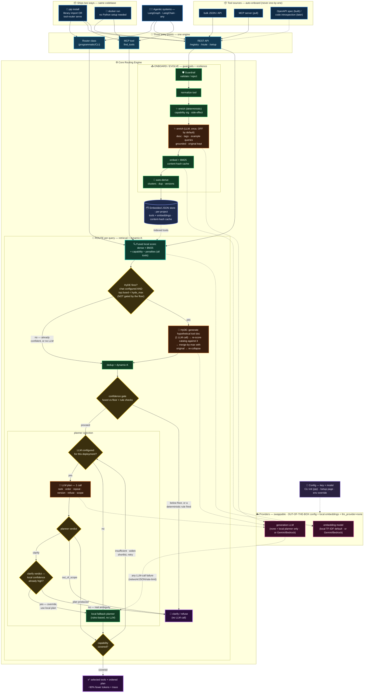

# Architecture — Intelligent Tool Router (Routing-as-a-Service)

> Master architecture / ADR for the tool router. This is the rich single view — see the detail
> docs (`engine-design.md`, `integrations.md`, `integration-plugability.md`, `onboarding.md`,
> `storage.md`) linked per section.

## 1. Product in one line

A **routing-as-a-service** platform ("Kapa for tools"). A client onboards their tool registry
once; thereafter each query hits our engine and gets back the small, high-precision set of tools
(+ an ordered call plan) the agent should actually see — cutting tokens and raising accuracy.

**Ships two ways, same codebase:** `pip install` (as a library — `from tool_router import
Router` — or a service via `tool-router serve`), or one `docker run` with no Python setup at
all. Full details in §5.

## 2. System shape — the architecture



**Legend:** 🔵 client/source · 🟦 entry point · 🟩 local & free · 🟩 teal = fused retrieval core ·
🟡 decision · 🟠 LLM (conditional/required) · 🟪 store · 🩷 providers · 🟪 config · 🟣 result.

**Reading the HyDE branch (`RET → HFIRE → ... → DD`) — it's a real fork, not an unconditional
inline step:**
- **`HFIRE` fires on exactly two conditions, both required:** a generation LLM is configured
  (`self._chat is not None`), **and** the top fused score from `RET` is below `hyde_max` (default
  0.38). If either is false — no LLM configured, or the query is already confident — control skips
  straight to `DD` and `HYDE` never runs. This is why HyDE is drawn as a genuine fork here, not
  folded into the main line: skipping it is the common case, not an edge case.
- **Critically, `HFIRE` has no lower bound tied to the out-of-scope floor.** A query that already
  scores *below* `out_of_scope_floor` (0.18) can still trigger `HYDE` — the check is only
  `top < hyde_max`, full stop. This is deliberate: a colloquial in-scope query ("how are the
  servers holding up?") can score ~0 purely from having no shared vocabulary with any tool
  description, which looks identical by score alone to a genuinely out-of-scope query. Excluding
  below-floor scores from HyDE eligibility would mean it could never rescue exactly the queries
  that need rescuing most.
- **Inside `HYDE`:** one LLM call generates a short hypothetical tool description for the query
  (system prompt: describe the ideal tool, don't answer the request); the *same* fused-scoring
  function re-runs with that hypothetical as the query text (a hypothetical tool doc tends to land
  much closer to real tool descriptions in TF-IDF/BM25 space than an informal user query does);
  the result is unioned with the original candidates by **max score per tool id** (HyDE can only
  raise a tool's score, never lower one retrieval already found); then dedup/version-collapse
  re-runs on the merged set, since the union can reintroduce a duplicate direct retrieval had
  already resolved. If the LLM call itself fails for any reason, `HYDE` no-ops and the original
  (pre-HyDE) candidates flow to `DD` unchanged — never a crash, never a stall.
- **Safety is enforced downstream, not by narrowing when `HFIRE` fires:** the merged, HyDE-boosted
  score still has to clear `out_of_scope_floor` at `GATE` — a hypothetical that matched nothing
  keeps the merged score below the floor and the query still ends in `CLR`. And even if the score
  clears the floor, `PVERDICT`'s `out_of_scope` branch is the LLM's own second check for a
  hypothetical that only *spuriously* matched real tools. Two independent backstops *after* the
  fact, rather than one restrictive gate *before* it.

**Reading the route path after the confidence gate — this is the part that was easy to
misread before:**
1. **`GATE` is a 3-way decision, not a yes/no.** Below the out-of-scope floor → empty, straight
   to `CLR`, no LLM ever consulted. A deterministic rule fires (destructive+sweeping,
   destructive+no-identifier, deictic-with-no-content, ambiguous-version-continuity) → also
   `CLR`, also no LLM. Only the remaining "proceed" branch goes on to `ACTIVE`.
2. **`ACTIVE` picks which planner runs** — `PLAN` (the LLM) if a provider is configured, `LOC`
   (the deterministic local planner) if not, or if `PLAN` fails for any reason (`PL -.-> LOC`
   edge — network error, bad JSON, rate limit, missing key). `LOC` is not a lesser stub; it's
   the same planner class used for the fully-offline 83% configuration.
3. **`PVERDICT` is where the LLM's own judgment splits three ways** — `out_of_scope` (the LLM
   itself vetoes the query as not servable by any candidate) goes straight to `CLR`; a normal
   `plan` goes on to `CAP`; and a **`clarify` verdict from the LLM does not go straight to `CLR`**
   — it goes to `ARB` first.
4. **`ARB` is the arbitration step** (easy to miss — it has no LLM-facing counterpart in earlier
   diagram cuts): if the local confidence gate had *already* judged this query high-confidence
   **and there's no destructive intent**, the LLM's `clarify` is treated as a probable
   small-model over-refusal and is **overridden** —
   the pipeline falls back to `LOC`'s deterministic plan instead of asking the user to clarify.
   Only when local confidence was *not* already high does `clarify` actually reach the user
   (`CLR`). This one branch is what recovers accuracy from 69% (raw LLM, over-clarifying) to 86%
   on the harness — see `engine-design.md` §6.
5. **`CAP` (capability check) is shared by both planners** — whichever one produced the plan
   (`PLAN` or `LOC`), `CAP` checks whether it covers every capability the query needs. If not,
   it widens the shortlist and sends control back to `ACTIVE` — i.e. the **same** planner that
   was active retries with a broader candidate set (bounded by `max_widen_rounds`, default 1),
   not a hardcoded retry against `PLAN` only.

**One engine, three entry points, everything else local by default.** The green/teal path
(fused retrieval, dedup, dynamic-K) runs unconditionally and never calls an LLM — that stays true
in every configuration. The orange nodes (`ENL` enrichment, `HYDE`, `PLAN`) are the *only* LLM
calls in the whole pipeline, and they are gated by configuration, not omitted from the design:
if `llm_provider` is set (e.g. Gemini), `PLAN` runs on every confident query and `HYDE` runs on
low-confidence ones; if unset (the shipped default), `PLAN` is skipped and `LOC` (the local
fallback planner) is used instead — `HYDE` cannot fire at all. Both paths are fully implemented
and both are exercised by the eval harness:

| Configuration | Orange (LLM) nodes active? | Harness accuracy |
|---|---|---|
| Default — `llm_provider=none` | No — `PLAN`/`HYDE`/`ENL` never run, `LOC` handles every query | **83%** (24/29), zero external calls |
| `llm_provider=gemini` (live-verified) | Yes — `PLAN` every confident query, `HYDE` when confidence is low | **90%** (26/29), ~98% token savings vs. dumping the full catalog |

Neither number is "the" accuracy of the system — each is the accuracy of one named configuration.
That's the efficiency story in one picture: the free path is not a fallback bolted on for when
the LLM is unavailable, it's the fully-functional default; the LLM path is what you opt into for
the extra ~7 points of accuracy, at the cost of a per-call API bill.

## 3. The three lifecycle stages

| Stage | Endpoint | Covers |
|---|---|---|
| **A · Onboard** | `POST /registry` | Registry guardrails + indexing |
| **B · Route** | `POST /route` | Hierarchical retrieval + dynamic-K/dedup |
| **C · Evolve** | `PATCH /registry/mutate` | Resilience / churn |

- **Onboard:** validate (guardrail) → enrich → index + auto-derive clusters/dup-groups/version-families (§6).
- **Route:** the hybrid pipeline (§7). Returns `selected_tools`, `plan`, `clarify`, `tokens_saved_pct`, `trace`.
- **Evolve:** apply add/remove/replace/upgrade/scale deltas → re-validate + re-index. Routing is
  by **capability**, not hardcoded ids → add routable immediately; remove degrades gracefully;
  replace routes by what it does; upgrade prefers current unless the query says "legacy".

## 4. Integration & Plugability  → `integration-plugability.md`, `integrations.md`

**Same engine, three plugs.** Build order: **engine → REST → MCP** (REST is the reliable demo
spine; MCP is the plug-and-play showcase). The transport is incidental — a benchmark harness or
grader would call the plain Python class directly — so the transport layer is optimized for a
reliable demo, not for scoring.

| Plug | Consumer | Use |
|---|---|---|
| **Router class** (`route()`) | direct/programmatic callers, e.g. a benchmark harness | always built |
| **REST API** (`/route`) | any app / language | primary real-world surface, max token savings |
| **MCP tool** (`find_tools`) | any MCP agent | plug-and-play showcase (MCP-tag) |

**How agents integrate** (full code in `integrations.md`):
- **REST pre-filter (primary):** a node calls `/route` with the query *before* the LLM turn and
  binds only the returned K tools. Works in LangGraph (a router node), LangChain
  (`bind_tools(tools_for(query))`), or any language over HTTP.
- **MCP:** the agent binds our `find_tools` tool and calls it mid-reasoning (LangGraph/LangChain
  via MCP adapters, or any MCP host).
- **Tool ids:** preserved exactly, never rewritten. A helper for sanitizing dotted ids into
  MCP/LLM-function-safe names exists (`importers/common.py::mcp_safe_name`) but is not currently
  invoked — our own MCP server only exposes meta-tools (`find_tools`, `register_tools`,
  `registry_status`), which have no dots, so no active sanitization is needed today. It becomes
  relevant only if catalog tools were ever exposed directly over MCP by name.

## 5. Packaging, Install & Config  → `storage.md`

**Ship BOTH**, from one codebase:
- **pip package** — `pip install` → `tool-router serve` (runs the REST service) **or**
  `from tool_router import Router` (library / programmatic use).
- **Docker image** — one `docker run` (no Python needed).
- **Language-agnostic** comes from the **REST API** (reachable via pip `serve` or Docker); only
  `import` is Python-only.

**Config (key + model) — no file editing:**
- **pip →** `tool-router init` (terminal wizard) / `tool-router config set …`.
- **REST →** `/setup` form: paste key, pick provider/model, Save.
- **Automation →** env vars override stored config (precedence: env var > stored config >
  built-in default).
- Key stored in OS keyring if available, else a `0600` fallback file; **never logged, never
  committed** (DQ-safe). Configurable: LLM provider, generation model, embedding
  provider/model. **No key is required for the default (fully local) configuration.**

## 6. Onboarding & Auto-Import  → `onboarding.md`

**Users never add tools one-by-one.** Ingestion is a two-stage pipeline — **guardrail → enrich**:
- **Guardrail (validate/reject):** malformed schema, vague/too-long description, bad id/name,
  duplicate id, bad param type, too many params, bad semver, dangling `replaced_by` — full rule
  table in `onboarding.md`.
- **Enrich:** deterministic (embeddings, BM25 tokens, capability signature, side-effect tag,
  normalization) + **one-time internal LLM enrichment** (description cleanup, auto-tags/synonyms,
  example queries) — grounded, original preserved, internal only. **Defaults OFF**: measured to
  blur near-duplicate tools in testing (see `eval_report.md`); opt-in via `TOOL_ROUTER_LLM_ENRICH=on`.
- **Auto-derive** clusters / near-dup groups / version families so it generalizes to unseen
  catalogs (validated against the catalog's provided maps).

**Import paths:** bulk API / JSON, **MCP-server auto-import**, and **OpenAPI-spec auto-import**
are all built (`tool-router import-mcp` / `import-openapi`); code-introspection import (reading
Python function signatures directly) is not built.

## 7. The routing engine pipeline (inside `/route`)  → `engine-design.md`

Ranking is **two-stage as implemented**: fused multi-signal retrieval (local) → **one** LLM call
for final planning. No regex. In order:

1. **Understand + embed query** — embed + BM25 tokenize. *[local]*
2. **Fused retrieval** — score every tool: `dense cosine + BM25 lexical + capability match
   − side-effect penalty ± version penalty`, sorted best-first. Name is never trusted; capability
   is baked into the fused signal, not a separate re-rank pass. *[local, free]*
3. **Conditional HyDE** — if confidence is not already high and an LLM is configured, generate a
   hypothetical tool description, re-retrieve, merge by max score. *[LLM, conditional]*
4. **Dedup** — collapse near-duplicate/version groups → one per group. *[local]*
5. **Dynamic-K gate** — confidence cutoff; low/none → clarify or empty. *[local]*
6. **LLM final rank + plan** — ONE structured call: final pick, ordering, repeat counts,
   capability/side-effect/version reasoning, refuse/clarify/out-of-scope. *[LLM]*
7. **Capability check + widen** — if a needed capability is missing, widen + re-plan (bounded).
8. **Return** — `selected_tools = unique(plan)` + trace + tokens_saved.

**Cost model:** only steps 3 (conditional) and 6 use the LLM — **one call/query** normally, two
on a low-confidence HyDE query, plus a rare bounded widen re-plan; everything else is free local
logic. Keeps us inside the LLM budget *and* maximizes token savings. **Graceful degradation:** if
the LLM is down, a deterministic local planner takes over — never crashes.

> A local cross-encoder re-ranker was designed as a possible middle stage (see
> `engine-design.md`) but is **not implemented** — the fused-score formula above does that job
> today. Documented as a future accuracy lever, not a current component.

## 8. Model & provider choices — provider-agnostic  [AI Depth: smart model selection]

Two components behind interfaces: **embedding model** + **generation LLM** (enrichment + final
rank/plan + conditional HyDE). **Out-of-the-box config = local TF-IDF embeddings +
`llm_provider=none`** — this configuration is fully offline (planner falls back to the
deterministic `LocalPlanner`, HyDE cannot fire); it is one supported configuration, not a
degraded mode. Swappable, via config only (no code change), to **Gemini** (live-verified) or AWS
Bedrock, which activates the LLM planner and conditional HyDE — see the accuracy-by-configuration
table in §2's diagram notes above. Embeddings computed once at onboarding and cached to a
per-project JSON file keyed by content hash (see §9).

**Conditional HyDE + LLM scope-arbiter** (`engine/hyde.py`) is OFF the default (confident) path
but fires whenever confidence is not already high (`top < hyde_max`, **including below the
floor**) with a chat model available — colloquial in-scope queries score ~0 lexically yet are
routable, so it must reach below the floor. It generates a hypothetical tool doc, re-retrieves,
merges by max score. **Out-of-scope safety is defense-in-depth:** the floor still applies to the
HyDE-improved score, AND the LLM planner is the scope arbiter via an explicit `out_of_scope`
verdict (distinct from an empty plan) that vetoes spurious matches. Offline (no chat) HyDE cannot
fire → local path unchanged. Measured: out-of-scope 4/4 safe (+ harness negative 2/2), vague
in-scope 3/4 rescued, **harness 26/29 (90%)**. Rationale it stays off the confident path: blind
semantic expansion hurts look-alike precision (dense embeddings 79% < TF-IDF 83%).

## 9. Storage  → `storage.md`

**Embedded JSON file store** (`tool_router/store.py`, in-process, **no server / no container**,
no external vector DB) holds per-tool embedding vectors + registry metadata as a content-hash
+ model-stamp keyed JSON file (`embeddings.json`); similarity is computed in-process (cosine).
**No Postgres, no vector DB dependency.** OS-agnostic location: `platformdirs` (pip) / `/data`
volume (Docker). **Per-project isolation** via an auto `.tool_router` marker id. **Conflicts
self-heal:** content-hash per tool (stale entries), embedding-model stamp (mismatch → cache
invalidated), `--rebuild` escape hatch. A vector-DB backend (e.g. Chroma) is a documented future
option behind the same interface, useful only at catalog sizes far beyond ~100 tools — see
§7 note and `storage.md`.

## 10. How each test category is won  → `engine-design.md`

| Category | Won by |
|---|---|
| single_tool | fused retrieval |
| multi_tool_ordered | LLM ordering (step 6) |
| deduplication | dedup + LLM final pick → one per group |
| repeat_count | LLM emits repeated ids |
| clarification | dynamic-K low-confidence → clarify |
| negative_out_of_scope | top < floor → empty; LLM refuses |
| fallback_widening | capability check + widen loop |
| backward_compat | version families + LLM version reasoning |
| cross_cluster | route by description/semantics, not name |
| positional_bias | fused scoring is order-independent |
| scope_overlap | capability/side-effect signals + LLM final pick |

## 11. Repo layout (as implemented)

Installable **`tool_router` package** at the core; REST/MCP/CLI are thin adapters over it.

```
tool-router/
├── README.md                 overview · ADR · run steps · results
├── pyproject.toml            installable package + `tool-router` CLI
├── Dockerfile · .dockerignore   wraps the package as the REST service
├── .env.example               placeholders only — NO real key
├── docs/                      eval_report.md · design/ (this ADR set)
├── tool_router/                THE PACKAGE (pip-installable, importable)
│   ├── domain/                 models.py (pydantic schemas) · errors.py
│   ├── engine/                 pipeline (orchestrator) · retrieval (fused scoring) · bm25 ·
│   │                            text (tokenize/signals) · confidence (dynamic-K gate) ·
│   │                            dedup · derive (clusters/versions/dup-groups) · ingest ·
│   │                            guardrail · planner (local) · llm_planner · hyde · enrich
│   ├── providers/               base (interface) · local_tfidf (default) · gemini · bedrock
│   ├── importers/               mcp_importer · openapi_importer · common
│   ├── adapters/harness_router.py   Router class → thin wrapper for run_benchmark.py
│   ├── api.py                  FastAPI: /registry /route /registry/mutate /health /setup
│   ├── mcp_server.py            MCP tools: find_tools · register_tools · registry_status
│   ├── cli.py                   tool-router version | validate | serve | mcp | init | config
│   │                            | import-mcp | import-openapi
│   ├── store.py                 persistence: JSON embedding/enrichment cache, config, secrets
│   ├── config.py · log.py       settings + logging
```

**Not implemented** (documented as future work, not currently active): a local cross-encoder
re-ranker stage, a vector-DB storage backend (Chroma/Qdrant), a browser Settings page beyond
`/setup`'s minimal form — see the "not built" notes in §7/§9 and `storage.md`/`engine-design.md`.

## 12. Tech stack (as implemented)

Python 3.11+ (dev sandbox: 3.13 in a **venv**, managed via **pyproject.toml**) · pydantic ·
platformdirs · FastAPI + uvicorn (`api` extra) · `mcp` SDK (`mcp` extra) · boto3 (`bedrock`
extra, optional) · stdlib-only Gemini client (`providers/gemini.py`, no extra needed). **No
runtime dependency on chromadb or sentence-transformers** — both remain optional/unused extras
in `pyproject.toml` for a possible future vector-DB or cross-encoder backend. Install:
`pip install -e .` + `tool-router serve`, or one `docker run`.

## 13. Design priorities

- **Working demo & technical execution:** a running service that handles unscripted queries,
  degrades gracefully with no LLM configured, returns a `trace` explaining every decision, and
  runs in one command via Docker or pip.
- **Depth over surface area:** hybrid retrieval + conditional HyDE + LLM planning + auto-derived
  metadata, with an eval report showing the measured iteration trajectory (24% → 83% local-only
  → 90% hybrid) and numbers at every step, not just a final claim.
- **A coherent lifecycle, not a pile of features:** unified onboard→route→evolve lifecycle; three
  entry points (class/REST/MCP) over one engine; auto-derived clusters/dup-groups/version-families
  that generalize to catalogs never seen at build time; confidence-gated dynamic-K; churn
  resilience.

## 14. Implementation status (as built)

| Phase | Scope | Result |
|---|---|---|
| **1** | Package scaffold · schemas/config · guardrail · ingest/enrich/auto-derive · local store · retrieval (BM25 + local embedding) · dedup · dynamic-K · harness adapter | ✅ built — 24/29 (83%) with zero LLM; guardrail 11/11 |
| **2** | LLM planner (Gemini live-verified; Bedrock in code, untested) · local fallback · versions · capability check + widen | ✅ built — 25/29 (86%) with arbitration |
| **3** | Churn engine · REST API · config CLI · Docker | ✅ built — churn 8/8; `docker run` verified |
| **4** | MCP server · conditional HyDE + scope-arbiter · importers (MCP + OpenAPI) | ✅ built — 26/29 (90%); MCP session-tested; both importers verified end-to-end |

**Not built** (documented, not shipped — see the "Not implemented" notes in `engine-design.md`
and `storage.md`): a local cross-encoder re-ranker stage, a vector-DB storage backend. Neither is
required for the core engine to function; both are documented as possible future accuracy/scale
levers.

## 15. Guardrails on ourselves

- Never commit an LLM/Bedrock key — `.env.example` / OS keyring / a `0600` file only.
- Honestly label real vs mocked: router/gateway/validator/churn are real; catalog tools are
  definitions only (the engine selects tools, it never executes them) — this is stated plainly,
  not buried.
- Don't overfit the visible evaluation cases — favor auto-derived, general-purpose metadata over
  hardcoded per-case logic; verify against an independent held-out query set before shipping.

## 16. Document index

| Doc | Covers |
|---|---|
| `architecture.md` | **this** — the rich master architecture |
| `engine-design.md` | engine internals, per-step detail, local-vs-LLM cost model |
| `integration-plugability.md` | the 3 entry points + build-order decision |
| `integrations.md` | how LangGraph/LangChain/any integrate (REST + MCP, with code) |
| `onboarding.md` | add/manage tools: guardrail → enrichment, auto-import (now/later) |
| `storage.md` | embedded JSON store, OS-agnostic paths, multi-project, conflicts, config UX |
| `diagrams.md` | detailed system/engine diagram (companion to §2) |
