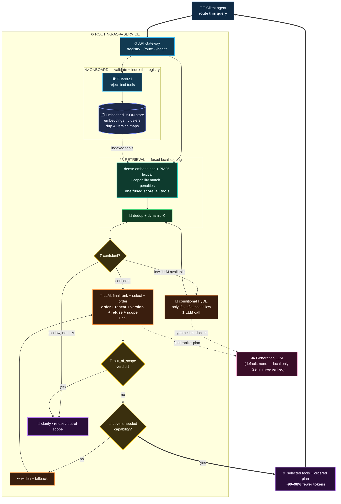

# Architecture Diagram — Intelligent Tool Router (Routing-as-a-Service)

Render on GitLab/GitHub, VS Code Mermaid preview, or https://mermaid.live

### Legend
- 🟢 **Green** = local & free (no LLM cost)  ·  🟩 **Teal** = the fused retrieval core
- 🟠 **Orange** = LLM call (conditional HyDE, or the required final-plan call)  ·  🟡 **Yellow** = decision gate
- 🔵 **Blue** = gateway / index  ·  🟣 **Purple** = result  ·  🩷 **Pink** = external provider

### "Is this just RAG?" — the one-line answer
The **retrieval core is RAG applied to tools** (embed tool schemas, retrieve the relevant
ones), fused with lexical (BM25) and capability signals into one score — there is **no
separate re-rank model stage**; that was considered in design but is not implemented (see
`engine-design.md`). We harden retrieval beyond vanilla RAG with **hybrid signals**,
**dynamic-K**, **dedup**, a **clarify/refuse/out-of-scope** path, **conditional HyDE** for
low-confidence queries, and an **LLM planner that also arbitrates scope** — so look-alike
tools, ordering, versioning, and vague queries are all handled, not just nearest-neighbor
lookup. The engine runs fully offline by default (no LLM); Gemini is the supported LLM
provider.
