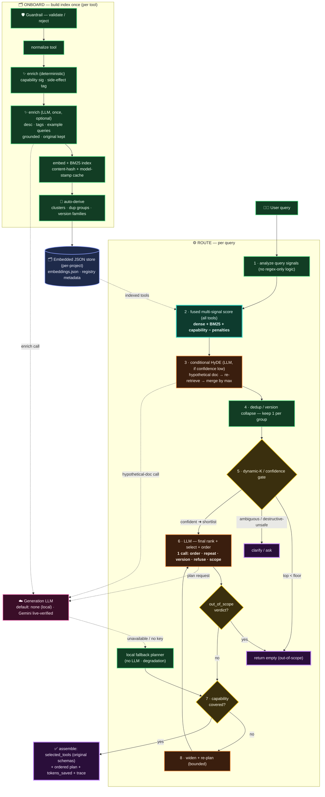

# Routing Engine — Internal Design (as implemented)

The engine is the core "brain" behind both entry points (REST / MCP).
It runs in two phases: **build the index once** at onboarding, then **route per query**.

```
ONBOARD (once per registry)                ROUTE (every query)
  guardrail validate/reject                  analyze query (signals, no regex-only logic)
  normalize + enrich (det. + optional LLM)   fused multi-signal scoring (all tools)
  embed each tool (cached by content hash)   conditional HyDE (if low confidence + LLM)
  build sparse (BM25) index                  dedup near-identical / version collapse
  auto-derive: clusters,                     dynamic-K confidence gate (empty/clarify/proceed)
    near-dup groups,                         LLM: final rank + select + order (1 call)
    version families                         out-of-scope check -> widen loop (bounded)
                                              arbitration -> assemble result + trace
```

**Ranking is two-stage as implemented:** fused local multi-signal retrieval (dense + lexical +
capability, all combined in one score) → **one** LLM call for final ranking/selection/ordering.
A separate cross-encoder re-rank stage was considered in design but **is not implemented** — see
the note at the end of this document. No regex-only query parsing; signal extraction lives in
`engine/retrieval.py::analyze_query`.

**Models (provider-agnostic):** one **embedding model** (retrieval vectors) + one **generation
LLM** (enrichment + conditional HyDE + final planning). Both behind provider interfaces
(`tool_router/providers/`). **Out-of-the-box default configuration = local TF-IDF embeddings +
`llm_provider=none`** (the engine is fully functional offline in this configuration — the LLM
planner step is skipped entirely in favor of the deterministic `LocalPlanner`). Live-verified
alternative *configuration*: **Google Gemini** (`providers/gemini.py`, chat + embeddings) set via
`TOOL_ROUTER_LLM_PROVIDER=gemini` — this is a config choice, not a code path that's "not built";
once set, the LLM planner (Step 6) and conditional HyDE both become active.
Embeddings must be consistent within one index (enforced by a model-stamp check in the
persistence layer).

**Note on "no LLM" throughout this document — it is used in two distinct, narrower senses, never
as a blanket claim about the whole system:**
1. **Retrieval-stage sense** (§2 below): the fused dense+BM25+capability score is pure computation
   and *never* calls an LLM, in any configuration — even with Gemini configured, retrieval itself
   stays LLM-free; only Step 6 (planning) and, conditionally, HyDE call out.
2. **Default-configuration sense**: with no LLM provider configured, Step 6 uses `LocalPlanner`
   instead of `LLMPlanner`, so *that specific configuration* makes zero LLM calls anywhere in the
   pipeline. This is the configuration the **83%** accuracy number below refers to. Configure an
   LLM provider and Step 6 (and conditionally HyDE) start calling it — accuracy rises to **86–90%**
   (see the comparison table in the confidence-gate/Step 6 sections below). Both numbers are real;
   they measure two different configurations, not a contradiction.

---

## Diagram



**Legend:** 🟦 Onboard · 🟩 Local & free · 🟩 Teal = fused retrieval core · 🟨 Decision gate ·
🟧 LLM (conditional/required) · 🩷 External (generation LLM) · 🟪 Result / store.

---

# Onboarding stage (detailed)

**When it runs:** once when a registry is first submitted, and again whenever the registry is
mutated (`RoutingEngine._build_index`, called from `__init__` and `apply_mutation`). **Input:**
a catalog of tool definitions. **Output:** a validated, enriched, indexed in-memory registry
(plus a persisted embedding cache).

**Pipeline (order matters — validate before spending work on enrichment/embedding):**

```
tool definition
   → Step 1: Guardrail (validate / reject)          [deterministic]  engine/guardrail.py
   → Step 2: Enrich (deterministic + optional LLM)  [mixed]          engine/ingest.py, engine/enrich.py
   → Step 3: Embed (text → vector)                  [model-based]   providers/*, store.py cache
   → Step 4: Derive maps (clusters/dupes/versions)  [deterministic] engine/derive.py
```

- **tool definition**: a JSON object with at least `id`, `name`, `description`, `parameters`
  (list of `{name, type, required}`), `returns`; optional `cluster`, `tags`, `side_effects`
  (`read`|`write`|`destructive`), `version` (semver), `deprecated` (bool), `replaces`,
  `replaced_by`, `aliases`.
- **embedding model**: converts text to a vector for retrieval. Distinct from the **generation
  LLM** (used for enrichment, conditional HyDE, and final planning).

## Step 1 — Guardrail (validation) — deterministic

**Purpose:** reject malformed or low-quality tools before indexing (`engine/guardrail.py`). This
is the registry intake validator, verified against an internal set of valid/invalid submission
fixtures (11/11 pass with the exact expected reason codes).

The **initial catalog** is validated **leniently** (issues logged, tools kept — it's the trusted
ground truth); **new submissions** via `/registry/mutate`, `import-mcp`, or `import-openapi` are
validated **strictly** (rejected with a reason).

| Category | Rule |
|---|---|
| Structural | JSON parses; required fields present; `id` matches the guardrail's id pattern; each param `type` is a known type; param count within limit; `version` is valid semver if present |
| Referential | `id` unique within the catalog; `replaced_by` (if present) points to an existing tool |
| Quality | description not too vague/short, not too long |

**Result per tool:** `accepted`, or `rejected` with a specific reason code (e.g.
`DESCRIPTION_TOO_VAGUE`, `DUPLICATE_ID`, `MALFORMED_JSON`).

## Step 2 — Enrichment — deterministic part + optional LLM part

**Purpose:** turn a raw tool into a richer entry retrieval can match well. Deterministic
enrichment always runs (`engine/ingest.py`); LLM enrichment runs once at ingest — not per
query — when a generation LLM is configured (`engine/enrich.py`), and results are cached by
content hash so repeat runs cost nothing.

**Deterministic enrichment (always):**
- **capability tokens**: derived from params + description + returns (used for capability-match
  scoring and least-privilege penalties).
- **side-effect tag**: from the `side_effects` field.
- **tokens**: tokenized name + description + cluster (`engine/text.py::tokenize`).

**LLM enrichment (one-time at ingest, optional, `TOOL_ROUTER_LLM_ENRICH`):**
- Produces a clearer description, extra tags, and example queries — merged into the *internal*
  search text only.
- **System prompt (fixed, `engine/enrich.py`):** "You expand tool metadata for a search index...
  Rephrase and clarify ONLY what the metadata itself says. NEVER invent capabilities, parameters,
  or behaviours the tool does not declare." Structured JSON output.
- **Safety rules:** the ORIGINAL description is what `selected_tools` returns to clients — the
  enrichment never leaves the internal retrieval layer. It is grounded (may only
  rephrase/expand real metadata).
- **Measured caveat:** live testing found that enrichment can *blur* near-duplicate tools (e.g.
  routed "total revenue" to `fetch_quarterly_earnings` instead of `get_revenue_report`) — see
  `eval_report.md`. Treat it as a recall aid for thin catalogs, not a precision improvement.

## Step 3 — Embedding — model-based, cached

Convert each tool's (enriched) text into a vector.

- **One embedding model per index** — tools and queries are embedded with the same model/space.
  Provider-agnostic (`tool_router/providers/base.py` interface); **default = local TF-IDF**
  (`providers/local_tfidf.py`, zero dependencies, corpus-fitted at index build time); swappable
  to Gemini embeddings (`providers/gemini.py`, live-verified).

### TF-IDF in detail (`providers/local_tfidf.py`, the default embedding provider)

TF-IDF (**Term Frequency × Inverse Document Frequency**) turns text into a vector where each
dimension is one word and the weight reflects how much that word matters *for this document*:

- **TF (term frequency)** — how often a word appears in *this* tool's text. More occurrences →
  higher weight (the word is central to what the tool does).
- **IDF (inverse document frequency)** — how *rare* the word is across the whole catalog. Common
  words ("get", "the") appear in nearly every tool and get a low IDF (not distinguishing); rare
  words ("attachment", "rollback") appear in a handful of tools and get a high IDF (very
  distinguishing). `idf(term) = ln((1 + N) / (1 + df)) + 1`, where `N` = tool count and `df` =
  number of tools containing the term.
- **weight = TF × IDF** — a word only scores high if it's *both* frequent in this tool's text and
  rare across the catalog. Query and tool vectors built this way are compared with cosine
  similarity — that's what the "dense" score in fused scoring means here.

This codebase's specific implementation:
- **Augmented TF**: `0.5 + 0.5 · (tf / max_tf)`, normalized by the document's own most frequent
  term — a long description doesn't win purely by repeating words more times in absolute count.
- **IDF fitted once per catalog** at onboarding (`fit_documents`), over `content_tokens` with
  stopwords already stripped.
- **Sparse vectors** — `{term: weight}` dicts, not fixed-length arrays; only terms that actually
  occur get an entry. This is why `Vector` (`domain/models.py`) is `dict[str, float] | list[float]`
  — sparse for TF-IDF, dense for Gemini — and `cosine()` (`engine/text.py`) handles both.
- **Unseen query terms** get a neutral `idf = 1.0` instead of being dropped, so a query word never
  seen in any tool description still contributes (BM25 catches it too, independently).
- **Why TF-IDF by default, not a neural embedding**: zero dependencies, zero network calls, fully
  deterministic (same corpus → same vectors → reproducible benchmark runs), and strong enough at
  catalog sizes of ~64–100 tools where queries and tool descriptions share vocabulary heavily.
- **Corpus-relative, not corpus-independent**: unlike a fixed neural model, TF-IDF's vectors depend
  on the whole catalog's word-rarity statistics — this is why the cache stamp includes a corpus
  hash (`local-tfidf:<hash>`): *any* catalog change invalidates every cached vector, not just the
  changed tool's.

**TF-IDF vs BM25 — not the same signal.** Both are lexical, corpus-statistics-based scores, but
they're used for different things here: TF-IDF (via cosine similarity) is the "dense" component of
fused scoring; BM25 (`engine/bm25.py`, Okapi, K1=1.5, B=0.75) is the separate "bm25" component,
saturation-normalized (`score / (score + 3.0)`, not max-normalized — max-normalization would hand
any garbage query a 1.0 and destroy out-of-scope detection). They're combined, not substituted for
each other, in the fused formula in §2 below.
- **Decoupled from the generation LLM** — chat/planning models are not used for embeddings.
- **Persistence + model stamp.** Vectors persist in a per-project JSON file
  (`tool_router/store.py`, `embeddings.json`), keyed by a hash of each tool's content AND the
  embedding provider's "stamp" (model id, or a corpus hash for TF-IDF). If the stamp changes,
  the cache is invalidated and re-embedded — vectors from two different models are never mixed.
- **Content-hash cache** — restarts are free; only new/changed tools are re-embedded after a
  mutation.

## Step 4 — Derive maps — deterministic (`engine/derive.py`)

Computed from embeddings + metadata, held in memory (not separately persisted; cheap to
recompute at index-build time).

- **Clusters** — use each tool's `cluster` field if present; else assign by nearest embedding
  centroid, with a *relative margin* test (best cluster must clearly beat the runner-up) rather
  than an absolute similarity threshold, so it works across embedding scales.
- **Near-duplicate groups** — pairwise cosine ≥ threshold + parameter-name overlap, within the
  same cluster and same side-effect class, unioned via union-find. Also honors the catalog's own
  `near_duplicate_groups` metadata when present.
- **Version families** — grouped by base name (stripping a `_v<N>` suffix) and linked via
  `replaces`/`replaced_by`; `deprecated` marks the non-current member. Routing rule: prefer
  current unless the query has an explicit legacy signal.

## Determinism summary (onboarding stage)

| Step | Nature |
|---|---|
| Guardrail | Deterministic (rules) |
| Deterministic enrichment | Deterministic |
| LLM enrichment (optional) | LLM / non-deterministic |
| Embedding | Model-based; TF-IDF is deterministic, hosted models are reproducible per call |
| Derive maps | Deterministic algorithms |

## System prompts in the whole system

Three generation-LLM system prompts, all in code (not test-case-specific):
1. **Enrichment** (`engine/enrich.py`) — onboarding stage, one-time per tool.
2. **HyDE** (`engine/hyde.py`) — generates a hypothetical tool description for a low-confidence
   query; explicitly told to describe a tool, not answer the request.
3. **Planner** (`engine/llm_planner.py`) — selects/orders tools from the shortlist, enforces
   version/side-effect rules, and is the **scope arbiter** (explicit `out_of_scope` field,
   distinct from an empty plan) — see Step 6 below.

Fused retrieval (embeddings + BM25 + capability scoring) uses **no** generation-LLM call.

---

# Route stage (per query)  (`RoutingEngine.route`, `engine/pipeline.py`)

## 1. Analyze the query (`engine/retrieval.py::analyze_query`)

Extracts signals used by scoring and the confidence gate: content tokens (via
`engine/text.py::tokenize`, which handles snake_case splitting, plural stemming, and
verb-particle joining), destructive-intent / sweeping-scope / legacy-signal / continuity /
deictic-reference detection, an identifier/entity check, and an enumeration count (for
repeat-count queries). This is signal extraction feeding the scorer and gate below — not a
substitute for the LLM's semantic judgment, which still does the precise final call in Step 6.

## 2. Fused multi-signal scoring — the retrieval core (`engine/retrieval.py::score_tools`)

For **every** tool in the registry, compute one score:

```
fused(t) = w_dense · dense(q, t)        # cosine similarity of embeddings (semantic)
         + w_bm25  · bm25(q, t)         # BM25 lexical overlap (exact words / ids)
         + w_cap   · capability_match(t) # shared capability tokens with the query
         − side_effect_penalty          # destructive tool, no destructive intent in the query
         − deprecated_penalty           # non-current version, no legacy signal in the query
         − pii_penalty                  # tool exposes sensitive fields, query doesn't ask for them
```

Weights live in `config.RetrievalWeights`, tunable via `TOOL_ROUTER_W_*` env vars (defaults:
`w_dense=0.45, w_bm25=0.45, w_cap=0.10, side_effect_penalty=0.15, deprecated_penalty=0.15`;
the sensitive-field penalty is a fixed `0.10`). This single fused score is what the codebase
actually computes — there is no separate coarse-then-rerank pass; capability/side-effect/version
signals are folded directly into one ranking pass, not a second model stage. Tools are scored in
full (no cluster pre-filter) at catalog sizes up to ~100+ — verified to hold accuracy and token
savings at a 104-tool scale-stress test.

**The fixed schema retrieval produces (`retrieval.py::Candidate`, a plain dataclass):**

```python
Candidate:
    entry: IndexedTool   # the scored tool (normalized + enriched)
    fused: float         # the combined score above — this IS "the confidence score"
    dense: float         # TF-IDF/embedding cosine component alone
    bm25: float          # BM25 lexical component alone
    capability: float    # capability-token overlap component alone
```

Every downstream stage — HyDE merge, dedup, the confidence gate, the LLM planner's shortlist —
passes around `list[Candidate]`, always sorted `(-fused, tool_id)` for deterministic tie-breaking.
The per-signal breakdown is kept (not discarded after ranking) and surfaced in the response
`trace`, so a caller can see *why* a tool scored the way it did, not just that it did.

**"Confidence" is not a separate model — it's `Candidate.fused` reused.** There's no distinct
confidence-scoring step; the same scalar that ranks tools is what the gate below reads to decide
empty/clarify/proceed, what sizes the dynamic shortlist, and what gates HyDE. One number, four
consumers.

- **Names are never a special signal** — cross-cluster traps (`email_report`, `send_campaign`)
  score low because their *descriptions* aren't about 1:1 email.
- **Precise disambiguation** among close-scoring look-alikes is finished by the LLM in Step 6,
  which sees the shortlist and makes the final structured pick.

## 3. Conditional HyDE (`engine/hyde.py`) — LLM, only when confidence is not already high

Colloquial/vague in-scope queries ("how are the servers holding up?") can share almost no
lexical overlap with tool descriptions, scoring near zero — indistinguishable by score alone
from a genuinely out-of-scope query ("what's the capital of France?"). Blind semantic expansion
is *not* the default retrieval path precisely because it measurably hurts look-alike precision
(dense embeddings 79% < TF-IDF 83%, and LLM enrichment separately measured to blur near-dup
tools) — HyDE exists as a narrow, conditional rescue for the specific band where retrieval is
weak, not a general retrieval upgrade.

**Trigger condition — exact code (`pipeline.py::route`):**
```python
top0 = candidates[0].fused if candidates else 0.0
if self._chat is not None and top0 < conf.hyde_max:
    candidates, hyde_info = apply_hyde(query, candidates, ...)
```
Two conditions, both required: a generation LLM is configured (`self._chat is not None`), **and**
`top0 < hyde_max` (default **0.38**). That's it — **there is no lower bound tied to the
out-of-scope floor.** HyDE is allowed to fire even when `top0` is already below
`out_of_scope_floor` (0.18). This is deliberate, not an oversight: a colloquial in-scope query can
score ~0 from zero lexical overlap, which looks identical (by score alone) to a true out-of-scope
query — restricting HyDE to "floor ≤ top < hyde_max" would mean it could never rescue the
worst-scoring in-scope queries, exactly the ones that need it most. (`hyde.py`'s own module
docstring and a comment in `config.py` still describe the older `floor <= top < hyde_max` design;
the shipped `pipeline.py` gating is `top < hyde_max` only, and that's the version that actually
runs and is measured below.)

**The HyDE pass itself (`apply_hyde`), step by step:**
1. **`generate_hypothetical(query, chat)`** — one LLM call with a fixed system prompt: *"write a
   SHORT description (1-2 sentences) of the single ideal API tool that would fulfil it... Describe
   only what such a tool does; do not answer the request."* Returns `None` (no-op) if the call
   fails for any reason (`ProviderError`) — HyDE degrading is silent and safe, never a crash.
2. **Re-score against the hypothetical** — the same `score_and_collapse` fused-scoring function
   used for the real query (§2) is run again, but with the *hypothetical tool description* as the
   query text. Because it's phrased like a real tool doc, it tends to land much closer to actual
   tool descriptions in TF-IDF/BM25 space than the original informal query did.
3. **`_merge_by_max`** — union the original candidate list with the hypothetical-query candidate
   list; where a tool appears in both, keep whichever `fused` score is higher. Not concatenation,
   not averaging — a straight per-tool max, so HyDE can only ever raise a tool's score, never
   lower it below what direct retrieval already found.
4. **Re-`collapse`** — re-run near-duplicate/version dedup (§4) on the merged set, since the union
   can reintroduce a duplicate that direct retrieval had already collapsed away.

**Out-of-scope safety is defense-in-depth, applied *after* HyDE runs, not a restriction on when it
runs:**
1. The confidence floor (`out_of_scope_floor`) still applies to the HyDE-*improved* score in the
   gate that runs afterward (§5) — a hypothetical that matches nothing keeps the merged top score
   below the floor → empty result, same as if HyDE had never fired.
2. The LLM planner (Step 6) is the **scope arbiter**: an explicit `out_of_scope` field (distinct
   from simply returning an empty plan) lets it veto a query whose hypothetical only *spuriously*
   matched real tools even though the merged score cleared the floor.

Offline (no LLM configured), `self._chat is None` so the trigger condition is never true — HyDE
cannot fire and the local-only path is completely unaffected. **Measured**
(`eval_report.md`): out-of-scope safety 4/4 on adversarial probes plus the harness's own
`negative_out_of_scope` category holds 2/2; 3/4 genuinely vague in-scope queries are correctly
routed that previously scored ~0; full harness accuracy 26/29 (90%) with HyDE + the scope arbiter
vs 25/29 (86%) without.

## 4. Dedup / version collapse (`engine/dedup.py`)

```
for group in near_duplicate_or_version_groups:
    members_in_play = [t for t in candidates if t in group]
    if len(members_in_play) > 1: keep the highest-scoring one; drop the rest
```

Satisfies an `allow_any_of` scoring rule ("pick exactly one per group"). The LLM in Step 6 makes
the final call if remaining candidates are still genuinely close.

## 5. Dynamic-K confidence gate (`engine/confidence.py::decide`)

```
top = candidates[0].fused
if top < out_of_scope_floor:              return empty     # nothing matches -> out of scope
if destructive + sweeping-scope:          return clarify   # bulk irreversible action, confirm first
if destructive + no concrete identifier:  return clarify   # e.g. "cancel the meeting" -- which one?
if versioned family + ambiguous continuity signal: return clarify
if deictic pronoun object + near-empty content:    return clarify
shortlist = [t for t in candidates if t.fused >= top * shortlist_ratio][:shortlist_max]
```

High confidence → tiny shortlist → maximal token savings. These clarify rules are the
deterministic no-LLM safety net (documented general principles — destructive-without-referent,
unresolved-pronoun-object — not fitted to any specific test case); the LLM planner adds a
second, semantic clarify judgment on top, arbitrated as described next.

**Reading "confidence" off `top.fused` — the exact thresholds (`config.Thresholds`):**
- `out_of_scope_floor` (default **0.18**) — below this, nothing matches well enough to even
  attempt a plan → empty result, no LLM call.
- `hyde_max` (default **0.38**) — HyDE (§3) is allowed to fire whenever `top.fused < hyde_max`.
  **Note this check has no lower bound tied to the floor** — HyDE can fire even when `top.fused`
  is already below `out_of_scope_floor` (`pipeline.py::route`, checked as `top0 < conf.hyde_max`
  alone). That's deliberate: a colloquial in-scope query ("how are the servers holding up?") can
  score ~0 from zero lexical overlap, indistinguishable by score alone from true out-of-scope —
  HyDE needs to be allowed to try rescuing exactly that case. Out-of-scope safety is enforced
  *after* HyDE runs, not by restricting when it's allowed to fire — see the defense-in-depth list
  in §3. (The comments in `hyde.py`'s module docstring and `config.py` describe an older
  `floor <= top < hyde_max` design; the shipped `pipeline.py` gating is `top < hyde_max` only —
  this doc follows the code that actually runs.)
- `shortlist_ratio` (default **0.55**) and `shortlist_max` (default **8**) — the shortlist is
  *every* candidate scoring at least `top.fused × shortlist_ratio`, capped at `shortlist_max`. A
  runaway top score narrows the shortlist to almost nothing (max token savings); a close spread of
  scores widens it (more candidates handed to the LLM to disambiguate) — this is the "dynamic-K"
  behavior: shortlist size is *derived from* confidence, not a fixed constant.

## 6. LLM — final rank, select, order, scope (ONE call, `engine/llm_planner.py`)

Send the query + the **shortlist only** (compact schemas) and force structured JSON output:

```json
{ "plan": [ {"tool_id": "fin.get_revenue_report"},
            {"tool_id": "bi.generate_chart"},
            {"tool_id": "comm.send_email_with_attachment"} ],
  "clarify": false, "clarify_question": null,
  "insufficient": false, "needed_capability": null,
  "out_of_scope": false }
```

Choosing among a handful of clean candidates makes this cheap and accurate. In this one call the
LLM does the precise work retrieval intentionally leaves to it:
- **final selection** among look-alikes retrieval scored closely
- **ordering** — causal chains ("revenue → chart → email") → `multi_tool_ordered`
- **repeat counts** — same id N times → `repeat_count`
- **capability/side-effect/version reasoning** — needs an attachment? avoid an over-privileged
  tool? prefer current unless "legacy" is explicit?
- **scope arbitration** — an explicit `out_of_scope: true` verdict when none of the candidates
  genuinely serve the request (this is what makes below-floor HyDE safe, see §3)
- **refuse/clarify** — `clarify: true` with a short question when the request is too ambiguous

Prompt rules enforce: only use provided `tool_id`s (never invent one — ids not in the shortlist
are dropped by the adapter code, not just discouraged by the prompt), keep the plan minimal.

**What's actually sent per candidate (`_compact_tool`)** — deliberately minimal, not the full
`Tool` record: `tool_id`, `description`, `parameters` (name/type/required only), `side_effects`,
and, only when relevant, `deprecated`/`replaced_by`. Cluster, tags, and the raw embedding are left
out — the planner doesn't need them to choose among an already-narrowed shortlist, and leaving
them out keeps the prompt (and cost) small.

**Three safety nets enforced in code, not just prompted for:**
1. **Tool-id whitelist** — every `tool_id` the LLM returns is checked against
   `{c.tool_id for c in shortlist}`; anything outside that set is dropped and logged as a warning,
   never included in the plan. The model cannot cause an unknown tool to be called, full stop.
2. **Empty-plan disambiguation** — an empty `plan` is only accepted as a real answer if it comes
   with an explicit reason (`clarify`, `insufficient`, or `out_of_scope`). An empty plan with *no*
   reason is treated as a model slip, not an answer, and falls through to the local planner.
3. **Total degradation** — the LLM call is wrapped in `try/except ProviderError`; any failure at
   all (no key configured, network error, malformed JSON, rate limit) routes straight to the
   deterministic `LocalPlanner` fallback. The engine never crashes and never silently returns
   nothing because of an LLM outage.

`selected_tools = unique(plan tool_ids)`. **Provider-agnostic** — default none (local planner),
Gemini live-verified.

**Arbitration** (`engine/pipeline.py`): a planner-level `clarify` is treated as a second opinion.
When the local confidence gate already established high confidence and there is no destructive
intent, the LLM's clarify is more likely a small-model over-refusal than a real ambiguity, so the
pipeline falls back to the deterministic local plan instead. Measured to recover accuracy from
69% (raw LLM, over-clarifying) to 86% (with arbitration) on the harness.

## 7/8. Capability check + widen loop — resilience

```
for attempt in range(max_widen_rounds):   # bounded, default 1
    if plan_covers(needed_capability) and not result.insufficient: break
    widen()   # broaden the candidate shortlist toward the needed capability
    result = planner(query, expanded_shortlist)
```

Example: plan picked `send_email` (no attachment) but the task needs one → widen →
`send_email_with_attachment` enters the shortlist → re-plan. Bounded iterations cap cost.
Covers `fallback_widening`.

## 9. Graceful degradation — local planner (no LLM, `engine/planner.py::LocalPlanner`)

If no generation LLM is configured, or any LLM call fails for any reason (network, invalid
JSON, rate limit, missing credentials), a deterministic local planner takes over: it segments
multi-step queries, does a greedy IDF-weighted set-cover over shortlisted candidates for
implicit multi-tool steps, orders reads before writes, and infers repeat counts from detected
enumerations. This is not merely a stub — it is what scores 24/29 (83%) on the harness entirely
on its own, and it is what every LLM-path failure falls back to. The engine never crashes and
never returns nothing because of an LLM failure.

---

## Not implemented (documented honestly, not shipped)

- **Local cross-encoder re-ranker.** An earlier design considered inserting a re-rank stage
  between coarse retrieval and the LLM call (a small cross-encoder model scoring
  query/tool pairs jointly). This is **not built** — `sentence-transformers` remains an unused
  optional dependency in `pyproject.toml`. The fused-score formula in Step 2 does the
  discriminating work today; a re-ranker remains a possible future accuracy lever, not a
  current component.
- **Vector-DB storage backend (e.g. Chroma).** The store is a plain per-project JSON file with
  in-process cosine similarity (`tool_router/store.py`), not an embedded vector database. At the
  current catalog scale (order 100 tools) brute-force cosine is sub-millisecond and a vector DB
  adds no benefit; see `storage.md` for the full rationale and when it would become worthwhile.

---

## Output (for REST/MCP + demo)

```json
{ "selected_tools": [...], "plan": [...],
  "clarify": false, "clarify_question": null,
  "tokens_saved_pct": 0.91,
  "trace": { "decision": "...", "reason": "...", "hyde": {...},
             "top_candidates": [...], "dropped": [...] } }
```

The `trace` makes the routing decision inspectable — a caller *sees why* each tool was chosen.

---

## Test-category → mechanism map

| Category | Won by |
|---|---|
| single_tool | fused retrieval (§2) |
| multi_tool_ordered | LLM ordering (§6) |
| deduplication | dedup (§4) + LLM final pick → exactly one per group |
| repeat_count | LLM emits repeated ids, or the local planner's enumeration detection (§6/§9) |
| clarification | dynamic-K low-confidence gate (§5), arbitrated against the LLM's own clarify (§6) |
| negative_out_of_scope | top < floor → empty (§5); LLM `out_of_scope` verdict after HyDE (§3/§6) |
| fallback_widening | capability check + widen loop (§7/8) |
| backward_compat | version families (onboarding Step 4) + LLM version reasoning (§6) |
| cross_cluster | route by description/semantics, not name (§2) |
| positional_bias | fused scoring is order-independent (§2) |
| scope_overlap | capability/side-effect signals (§2) + LLM final pick (§6) |

---

## Cost model — local vs LLM, per route step

The key efficiency fact: **the generation LLM is used only in Steps 3 (conditional), 6
(required when an LLM is configured), and rare widen re-plans. Everything else is free local
logic.** With no LLM configured, EVERY step is local (this is the 83%-accuracy default). With an
LLM configured, a confident query costs exactly one call (Step 6); a low-confidence query adds
one more (Step 3, HyDE).

| Route step | Local or LLM? | Notes |
|---|---|---|
| 1 · Analyze query | 🟢 Local | signal extraction, no model call |
| 2 · Fused scoring (all tools) | 🟢 Local | embeddings + BM25 + capability, microseconds at this scale |
| 3 · Conditional HyDE | 🟠 LLM — only if confidence is low AND an LLM is configured | skipped entirely offline or when already confident |
| 4 · Dedup / version collapse | 🟢 Local, deterministic | uses pre-derived groups; no model, no API call |
| 5 · Dynamic-K / confidence gate | 🟢 Local | computed from the retrieval scores, before any LLM call — so out-of-scope/ambiguous queries never pay for an LLM call at this stage |
| 6 · Planner (rank/order/repeat/version/refuse/scope) | 🟠 **LLM — 1 call, when configured**; else the local planner | the only mandatory generation-LLM call in the confident path |
| 7/8 · Capability check | 🟢 Local | compares plan tools' capabilities vs the query's needs |
| 7/8 · Widen + re-plan | 🟠 LLM — only if needed | bounded (`max_widen_rounds`, default 1) |
| Assemble result + trace | 🟢 Local | builds the response dict + trace — no model |

**Per query with an LLM configured: 1 call normally, 2 on a low-confidence HyDE query, up to
~4 in the rare widen case. Zero calls with no LLM configured (the default).** This is what keeps
the system inside any LLM budget while still winning token savings, and what guarantees the
engine works with no external dependency at all.

---

## Key notes

- **The LLM planner (Step 6) is the single biggest accuracy lever when available** — combined
  with conditional HyDE and the scope arbiter it lifts the harness from 83% (local-only) to 90%.
- **Two components, provider-agnostic:** embedding model + generation LLM, both behind
  interfaces (`tool_router/providers/`). **Default = local TF-IDF + no LLM** (fully offline);
  live-verified alternative = **Google Gemini**. Embeddings must be consistent per index (enforced via a model stamp).
- **Weights `w_dense`, `w_bm25`, `w_cap`, and confidence thresholds** live in `config.py`,
  tunable via env vars, and were tuned against the 29-case suite plus validated on a separate
  held-out set (10/12) to check for generalization rather than overfitting.
